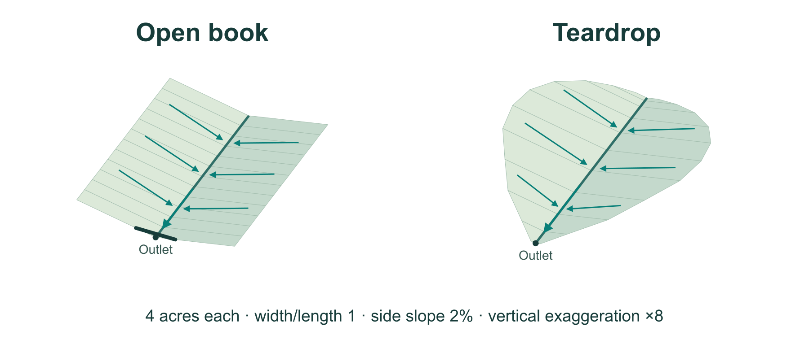
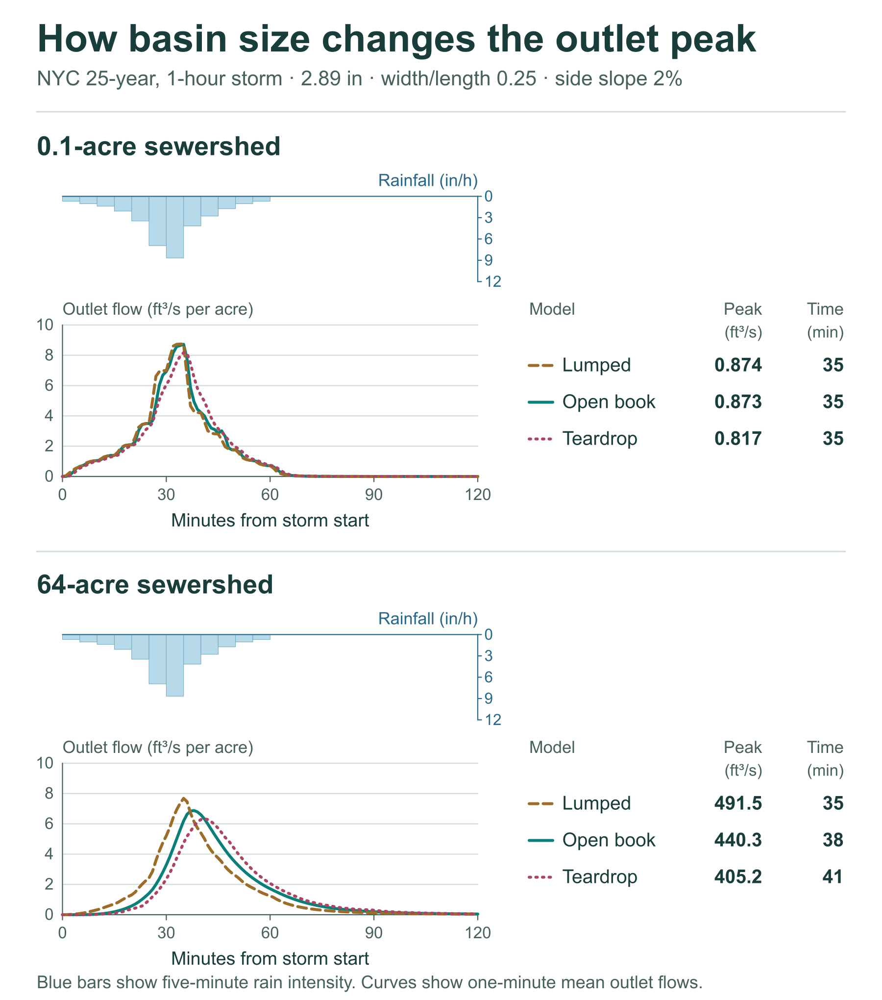

# Lumped Runoff vs. Distributed Runoff — When Does the Lumped Approximation Hold?

Caleb Buahin · November 23, 2026

If two models drain the same rainfall volume, can we use them interchangeably to size an outlet? On one of our test surfaces, the simpler model delivered 492 cubic feet per second at minute 35. The distributed model delivered 405 at minute 41. Both accounted for essentially the same rain.

Adding a multiprocess, multiscale, spatially explicit overland flow model to OpenSWMM gave us a reason to revisit this question. We could apply identical rainfall to the same area, use the same roughness, turn off losses and compare the hydrographs before any sewer routing. We ran 54 combinations of storm, area, width-to-length ratio and slope. Each combination has three native simulations, plus eight separate runs to check mesh sensitivity across four combinations.

## What disappears inside one subcatchment?

Picture an open book tilted toward its binding, then tilt the binding toward an outlet. Rain has a lateral journey down each page and a longitudinal journey along the fold. In this example a lumped SWMM reservoir uses an effective width of twice the binding length. That captures a representative lateral distance. A single storage depth has no way to distinguish water next to the outlet from water at the far end of the valley.

The distributed open book resolves both journeys. A third model uses a teardrop footprint and a narrower outlet. All three receive the same rain. Guo and Urbonas showed why drainage length and watershed shape matter when assigning an equivalent runoff-plane width. [Guo and Urbonas, 2009](https://doi.org/10.1061/%28ASCE%29HE.1943-5584.0000045).

*Figure 1. Each terrain encloses four acres and has a maximum width equal to its length. Arrows trace the route from the hillsides down the central valley. The marked outlet spans the central quarter of each downstream edge.*

## A small basin where lumping works, and a larger one where the peaks separate

Start with a one-hour, 25-year New York City design storm. The 2.89-inch point depth comes from NOAA Atlas 14. We applied a synthetic five-minute pattern, with the most intense block at minutes 30–35. Fix the width-to-length ratio at 0.25 and the side slope at 2%. [NOAA precipitation-frequency estimates](https://hdsc.nws.noaa.gov/pfds/).

On 0.1 acre, the lumped and open-book peaks are 0.874 and 0.873 ft³/s, both at minute 35. Even after doubling mesh resolution in both directions the open-book peak is within 0.4% of the lumped value. For an outlet-flow calculation that can tolerate a few percent and a few minutes, that agreement gives a concrete reason to use the simpler model under these conditions.

*Figure 2. The upper panel of each pair shows five-minute rainfall intensity on an inverted right axis in inches per hour. The curves show outlet flow per acre with width/length 0.25 and 2% side slopes. At 64 acres the lumped, open-book and teardrop peaks occur at minutes 35, 38 and 41 on the baseline meshes.*

At 64 acres, the same lumped formulation gives 491.5 ft³/s. The open book gives 440.3 ft³/s three minutes later. The teardrop gives 405.2 ft³/s six minutes later. If a second branch is cresting at minute 41, those six minutes matter. Mesh resolution also matters here. Refining the open book lowers its peak a further 12.8% and delays it two more minutes. On the small teardrop, refinement changes a 6.5% shortfall relative to lumped into an 18.8% shortfall. A close match on a single mesh is provisional.

## The sign can change

For a 64-acre basin at 0.5% side slope under the two-year storm, the elongated open book peaks 28% below the lumped model. Widen the basin from a width-to-length ratio of 0.25 to 4 and the open-book peak is 60% higher. Widening lengthens the sheet-flow path represented by the lumped reservoir while shortening the distributed valley.

Storm depth changes the answer too. On the elongated, gently sloping 64-acre teardrop, the 2-, 25- and 100-year events produce peaks 18, 23 and 28 minutes later than lumped. Those are rainfall return periods for one-hour totals. The peak discharges depend on the within-hour pattern we chose. Ghosh and Hellweger found storm-dependent peak biases when they aggregated an urban catchment model, with infiltration also influencing their results. Our loss-free test isolates the surface-routing contribution. [Ghosh and Hellweger, 2012](https://doi.org/10.1061/%28ASCE%29HE.1943-5584.0000405).

## The volume check every case should pass

With dry initial conditions, uniform rain and zero losses, the ultimate runoff volume should equal rainfall depth times area. At eight hours water may still be on the surface. The 64-acre, 25-year elongated open book at 2% side slope received 19,012 m³. About 19,007 m³ had passed the outlet and 5.33 m³ remained on the mesh. This independent accounting is a secondary check on the 2D solver. Peak magnitude and timing still have to be tested separately. That distinction also shows up in observed-event validation. [Broekhuizen et al., 2020](https://hess.copernicus.org/articles/24/869/2020/).

I would judge the approximation against the decision. For outlet volume after complete drainage, the loss assumptions set the answer. For peak capacity or the coincidence of two inflows, specify tolerances for discharge and time, vary storm and geometry, and check that the conclusion survives mesh refinement. For local flood depths or flow paths, a single subcatchment cannot provide the requested spatial result. Field observations are the next comparison when the question concerns an actual sewershed.

The interactive article lets you move all four sliders, inspect the hydrographs and volume ledgers, and download the engine input and report for any selection. [Explore the native simulation matrix on HydroCouple](https://www.hydrocouple.org/articles/runoff-timing/).
