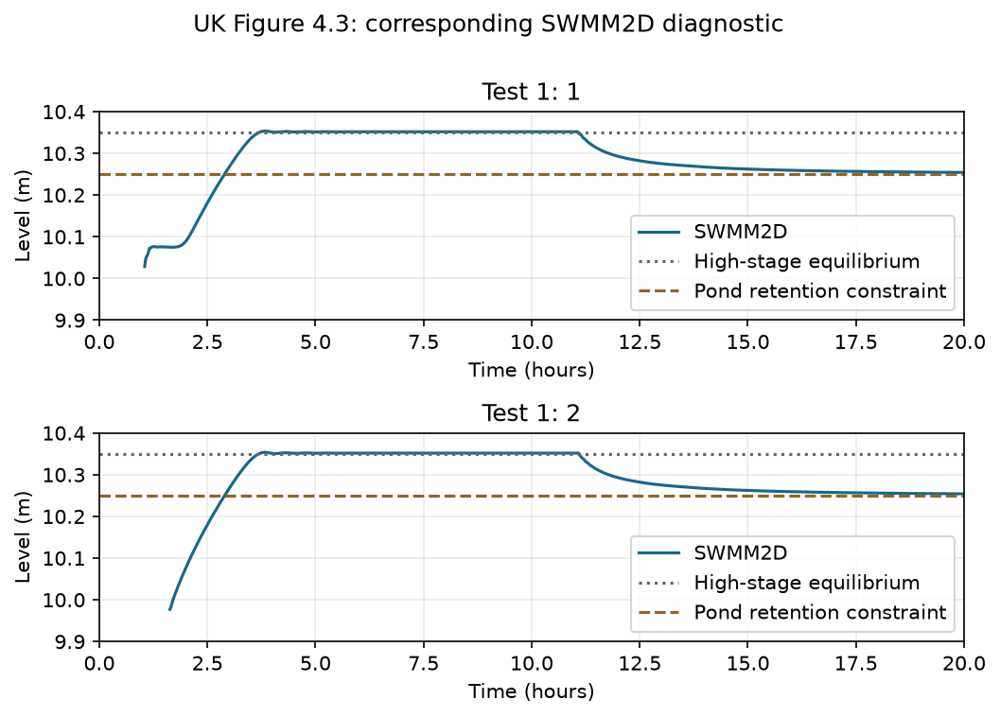
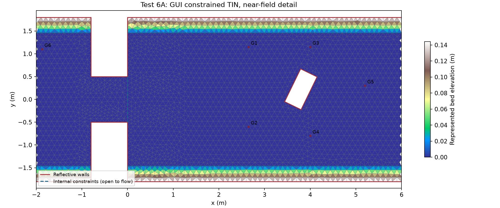
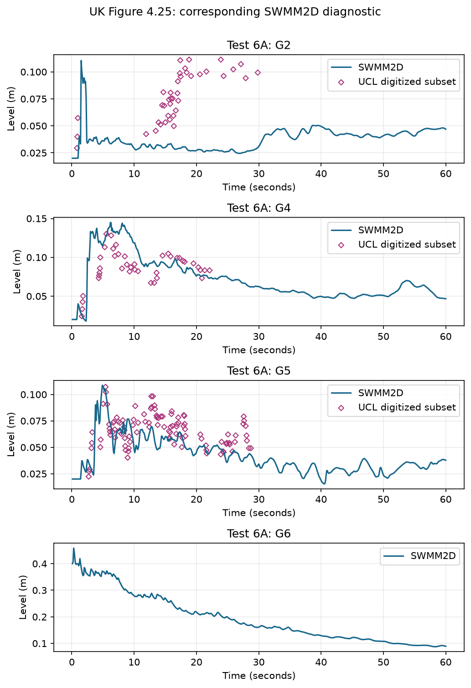
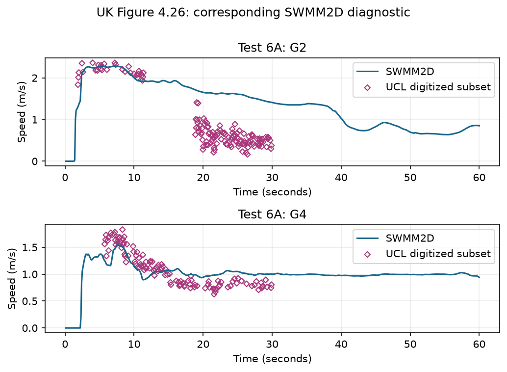
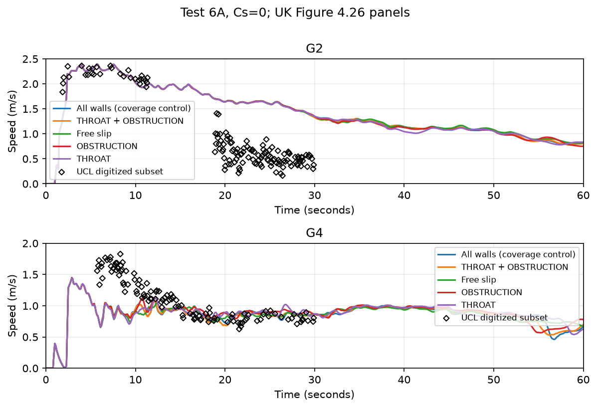
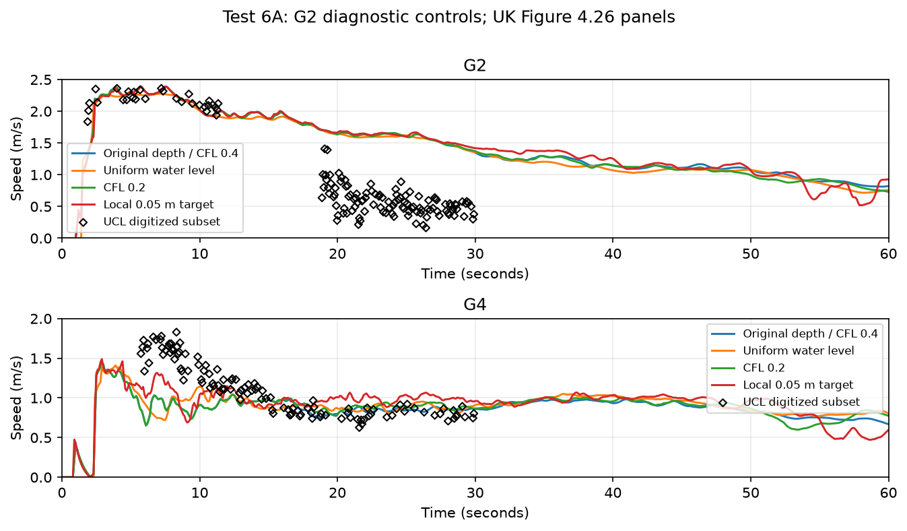
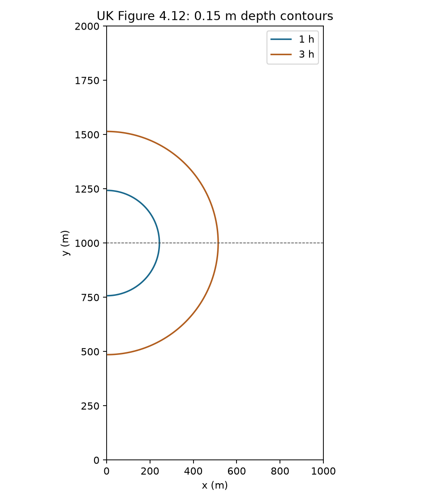
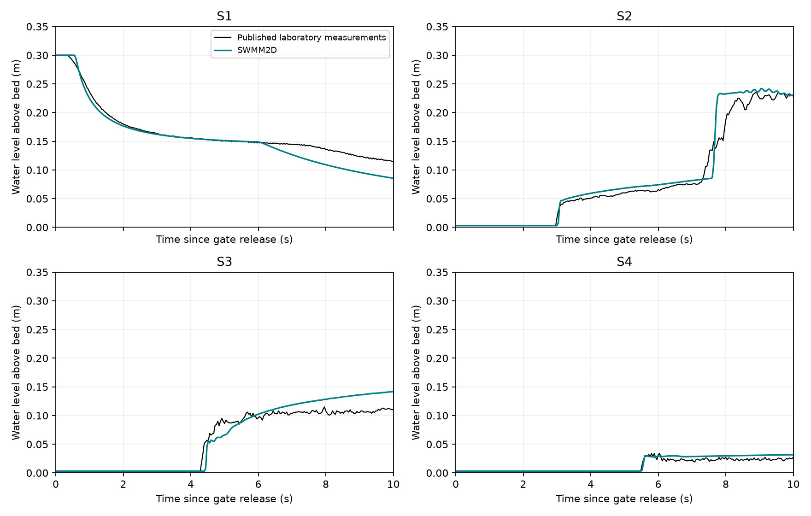
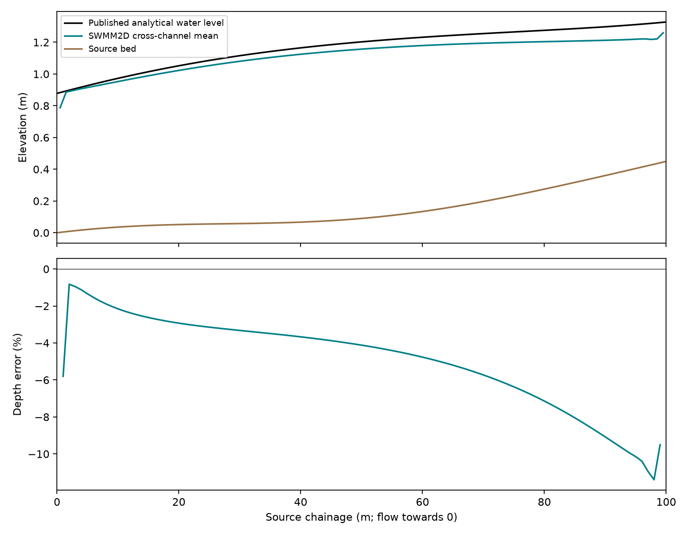
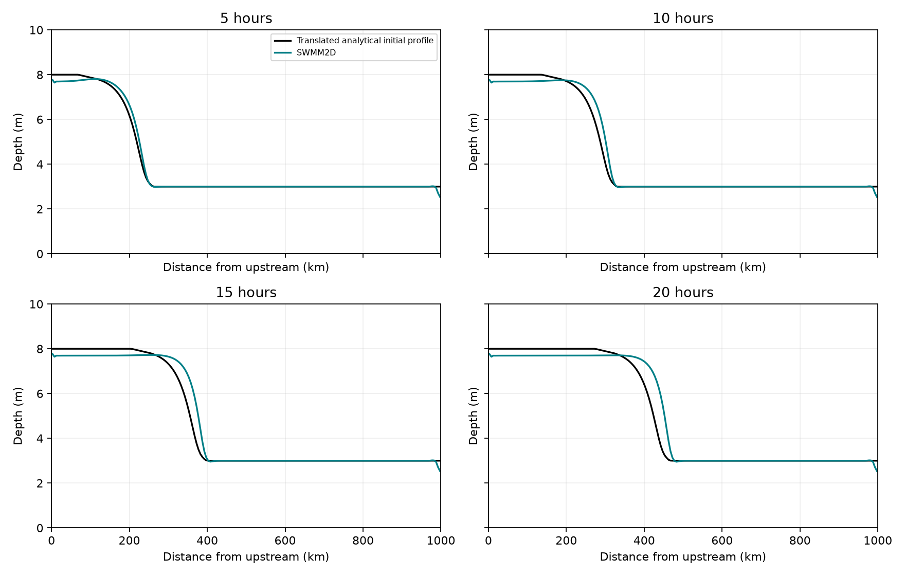

# Assessing SWMM2D with the UK hydraulic benchmarks

### Initial analytical evidence, a digitized laboratory comparison and a reproducible regression corpus

Codex
October 22, 2026

Updated October 27, 2026: native reconstruction qualification, the Test 6A reassessment and the subsequent bank/wall and targeted bank-resolution/momentum audits are included below.

The first implementation of the UK Environment Agency benchmark collection now provides executable SWMM2D models for Tests 1–5, 6A and 6B. This article presents the evidence available from that work: exact equilibrium checks, a limited comparison with published laboratory measurements, and numerical diagnostics from the historical scenarios.

The assessment is still partial. Original laboratory time series, the urban Test 8 inputs, a faithful Test 7 river/floodplain implementation, and spatial and temporal sensitivity studies remain outstanding. A completed simulation or an unchanged regression result does not establish experimental validation.

A fresh download of the official model archive matched the supplied archive byte-for-byte. Both contain Tests 1–7 and the supplementary profile workbooks, without the Test 8 inputs. The [source-verification record](evidence/official-source-verification.json) preserves the URL, date and checksums.

## What is being assessed

The controlling specification is Néelz and Pender’s 2013 Environment Agency report, SC120002/R. Its ten scenarios exercise disconnected ponding, depression filling, momentum over an obstruction, flood propagation, valley flooding, dam-break flow, river/floodplain exchange, urban rainfall and sewer surcharge.

These problems provide different kinds of evidence. Test 6A includes laboratory measurements. Test 1 supplies useful equilibrium constraints. Most other scenarios provide realistic hydraulic configurations without an independent measured or exact transient solution. Their results are therefore reported as diagnostics and regression evidence.

All comparisons in this assessment use SWMM2D with measured or analytical references where available. The complete [technical evidence report](evidence/report.html) retains the scenario coverage, output register, configuration, limitations and links to the underlying data.

## Analytical equilibrium preservation

Two separate lake-at-rest checks use the same CPU full shallow-water configuration as the UK assessment: explicit integration, second-order reconstruction and one timestep tier. One lake remains fully wet; the other contains an exposed region.

For a stationary lake, velocity is zero and the water surface is constant wherever wet. Here the exact reference is the equilibrium over the represented piecewise-flat bed. The test measures whether the solver preserves that state for 60 seconds. It does not establish transient accuracy or convergence over a smooth terrain surface.

| Lake | Maximum depth drift (m) | Maximum spurious speed (m/s) | Check |
|---|---:|---:|---|
| Immersed | 3.62e-13 | 7.79e-13 | PASS |
| Emerged | 3.91e-13 | 1.89e-12 | PASS |

The targets were declared before these runs: maximum depth drift of 0.000001 m, maximum speed of 0.000001 m/s, and continuity error no greater than 0.5%. The [analytical records and reference data](evidence/analytical/scores.json) identify the executed configuration. These are supplementary tests, outside the ten UK scenarios.

## Pond filling and retention

UK Test 1 raises a boundary stage, holds it while a depression fills, and then lowers it until the pond becomes disconnected. The specified high-stage equilibrium is 10.35 m; the retained pond level is 10.25 m.

At the prescribed 10 m spacing and 20-hour duration, SWMM2D’s final level at pond point 2 was 10.254157 m, a residual of 4.157 mm relative to the specified retention level. At the end of the high-stage hold, the residual was 1.717 mm relative to 10.35 m. The report preserves both residuals. Refinement and wetting/drying sensitivity are needed to distinguish the effects of the terrain representation and numerical treatment.

These reference levels constrain equilibrium. They do not provide an exact hydrograph for the transient filling and draining process.

## A limited laboratory comparison

UK Test 6A represents a dam-break wave interacting with an isolated building. The specification requests 0.1 m spacing, a 120-second simulation, Manning roughness of 0.01, water-level output at six gauges, and velocity output where measurements exist.

The Test 6 results below use the corrected GUI-generated constrained Delaunay mesh from 24 October 2026: 31,890 vertices and 61,642 triangles. The mesh follows the flume, dam abutments, 1 m opening and rotated building. It also restores the sloping side-bank strips from the dimensioned source drawing. The opening and bank toes remain internal edges; all 2,138 exposed edges are reflective walls. The minimum triangle angle is 30.0°, with actual edge lengths 0.0568–0.1557 m, so 0.1 m describes the nominal target.

The active area is 354 m² and the initial volume is 16.618 m³. This is a drawing-based geometric reconstruction, not a vertexwise reproduction of the pixelated DEM. The [mesh and constraint audit](evidence/uk-ea-2013-t6a/mesh-provenance.json) records the exact geometry and generator source identity. Drawing-versus-DEM interpretation and mesh sensitivity remain to be qualified. Because the correction includes boundaries and bank elevations, any result change cannot be attributed to triangle shape alone.

The earlier Cartesian, flat-bed Test 6 results are superseded. Their [metrics](evidence/history/cartesian-uk-ea-2013-t6a/metrics.json) and [input](evidence/history/cartesian-uk-ea-2013-t6a/model.inp) remain historical records. The [assessment history](evidence/assessment-history.json) identifies the new Test 6 executions and the unchanged earlier runs of Tests 1–5. Those remaining configurations still need their own domain, boundary and breakline mesh corrections.

For Test 6B, elevations are multiplied by 20 in accordance with the written specification and the explicit choice made for this assessment. The supplied 6B DEM scales XY but retains the 6A elevation matrix, so its side-bank heights conflict with that instruction. The [source-scale audit](evidence/uk-ea-2013-t6b/source-scale-audit.json) documents this discrepancy. The represented 6B bank height is 3.1 m; initial depths remain the prescribed 8 m upstream and 0.4 m downstream, with Manning roughness 0.05.

The supplied archive contains the terrain and gauge coordinates but no original measured time series. The initial comparison used a local 5×5 magenta diamond-pattern detector on Figures 4.25 and 4.26, excluding the legend. A subsequent connectivity audit found that this rule did not guarantee global isolation from other magenta graphics; some candidates touch neighbouring measurements or same-colour curves. The source-audit supplement distinguishes a stricter disconnected subset. Historical comparisons remain provisional and retain their original reference identities.

This recovered 611 markers, grouped into 446 samples by horizontal pixel column, across five gauge/quantity series. Most lie within the first 30 seconds. No reliable G6 markers survived recovery. The extracted points are a visibility-selected subset: the statistics below describe agreement with that subset and must not be generalized to the complete experiment.

| Gauge | Quantity | Samples | Covered time (s) | Bias | RMSE |
|---|---|---:|---:|---:|---:|
| G2 | Level (m) | 39 | 7.02 | -0.05091 | 0.05597 |
| G2 | Speed (m/s) | 141 | 17.92 | 0.6034 | 0.8188 |
| G4 | Level (m) | 41 | 13.47 | 0.01088 | 0.02414 |
| G4 | Speed (m/s) | 117 | 23.01 | -0.1428 | 0.3298 |
| G5 | Level (m) | 108 | 18.88 | -0.009182 | 0.01774 |

The mesh correction has not resolved the G2 mismatch: level RMSE is 0.056 m and speed RMSE is 0.819 m/s against the recovered subset. This assessment does not establish successful laboratory validation. Geometry, sampling and numerical-resolution effects require investigation with the original measurement records.

Bias and RMSE use the dimensional units shown in the quantity column. Predictions are sampled at the recovered observation times; intervals separated by more than one second are treated as gaps. No time shift is fitted to improve agreement.

Digitization uncertainty is conservatively one pixel in each axis, with physical conversions recorded per chart. Instrument uncertainty is unknown. SWMM2D’s reported speed is reconstructed from cell-edge fluxes; the original instrument and averaging metadata are still needed to establish the measurement operator. Overlapped observations, G6 and the original full records remain unavailable. Original-data recovery and an independent digitization review are required before a stronger laboratory-validation claim.

## Selective wall friction and Smagorinsky mixing

The 25 October follow-up executes 9 full-duration Test 6 configurations. Tangential wall drag is assigned separately to the throat and obstruction, with prescribed dimensionless Cw=0.01; this is a diagnostic sensitivity value, not a measured material property. A further Test 6A control applies the same coefficient to every exterior wall to assess wall coverage. Bed roughness, initial conditions and constrained geometry remain fixed. Coriolis is off. The earlier assessment’s speed used the edge-flux reconstruction; all configurations in this follow-up use accepted cell q/h, so wall effects are evaluated within its paired runs.

The tested wall and mixing settings do not explain the main Test 6A G2 discrepancy. With free-slip walls, G2 speed RMSE is 0.821976 m/s without mixing and 0.821925 m/s with Cs=0.1. Adding Cw=0.01 at the throat and obstruction changes it to 0.819115 m/s without mixing and 0.817577 m/s with mixing. Extending the same coefficient to every exterior wall gives 0.818514 m/s without mixing, a reduction of only 0.42% relative to free slip. Wall-only effects are mixed across the level and speed records; with mixing, the selected throat and obstruction walls produce small reductions in all five recovered-series RMSEs. The wall-energy ledger confirms that traction was applied, but the G2 speed and level disagreement remains substantial. These results do not justify treating these settings as a correction to the benchmark or changing the off/free-slip defaults. All 9 configurations completed their prescribed durations and passed the saved-depth and water-balance checks.

The coefficients were declared diagnostic values, not measured or fitted wall roughness. The all-wall coverage control was added after the regional runs showed little G2 change, retaining the same coefficient. Errors cover only visibility-selected digitized UCL markers, with missing G6 observations and unknown instrument uncertainty; the small changes do not establish a physical cause. Original measurements, drawing-versus-DEM geometry qualification, mesh/timestep and probe-sampling sensitivity, and wall-material evidence are still needed. Test 6B uses the chosen elevation scaling of 20 and has no independent measured reference; its numerical checks cannot establish physical accuracy.

The [wall-friction technical report](evidence/wall-sensitivity/report.html) reproduces the gauge panels and axis limits of UK Figures 4.25–4.28, with full-range companions. It retains the executed inputs, measured-subset errors, water balances, wall-energy accounting and exact binary identities. Laboratory comparison uses the recovered UCL markers only; Test 6B remains a numerical scenario. Native report-grid checks verify 0.1 s and 1 s output before the long runs.

## Investigating the G2 hydraulic jump

The follow-up isolates initial water-surface interpretation, timestep size and local mesh refinement in three full-duration Test 6A controls. All retain the same pinned solver, free-slip walls, Cs=0 and measured subset. The jump is assessed through its local depth/speed histories and a sampled critical-front trajectory, rather than water balance alone.

None of the three controls reproduces the measured secondary transition at G2. Speed RMSE is 0.821976 m/s in the original control, 0.809128 m/s with uniform initial water level, 0.822782 m/s with CFL 0.2 and 0.836779 m/s with local refinement. G2 level RMSE remains between 0.0550 and 0.0562 m. At 20 s, G2 remains strongly supercritical in all four runs; the sampled critical transition lies near x=2.78–3.15 m, downstream of G2 at x=2.65 m. Local refinement moves that front farther downstream. The sixteen analytical jump/reflection cases pass, supporting the basic shock and pressure response without establishing the correct two-dimensional front position.

One local refinement and one smaller-CFL control do not establish spatial or temporal convergence. The finer mesh also has a naturally smaller stable timestep. Comparisons retain the drawing-based geometry, prescribed roughness and visibility-selected digitized UCL subset; original full measurements and independent digitization review remain unavailable. Changes at G4 and G5 are appreciable and mixed, so improving one quantity does not select a better configuration. The canonical inputs and reviewed regression anchors remain unchanged.

The [G2 technical report](evidence/g2-jump-sensitivity/report.html) includes the one-factor comparisons, local flow maps, exact inputs, and sixteen analytical jump/reflection regression checks. The canonical UK inputs and reviewed anchors remain unchanged.

## Auditing effective geometry and momentum at G2

The executed mesh passes an independent check of dimensions, wall normals and gate connectivity. The source DEM has a narrower sampled throat and a larger shallow-water building footprint than the exact drawing. These differences remain explicit interpretation questions.

The missing G2 slowdown is strongly sensitive to spatial reconstruction. With the same coarse mesh, geometry, Manning n and RK2, disabling MUSCL changes the 20 s G2 state from 0.0271 m depth and 1.639 m/s speed to 0.1136 m and 0.444 m/s; native first order closely agrees. The broader reconstruction-disabled mesh retains the deeper, slower state at 20 s (0.1086 m, 0.501 m/s). Broad refinement with MUSCL enabled leaves the large G2 discrepancy: speed RMSE is 0.8304 m/s, versus 0.8220 m/s on the original mesh. This makes spatial reconstruction and its interaction with the irregular mesh and reflective walls the strongest next engineering lead.

These controls do not establish a correct replacement method or spatial convergence. Disabling reconstruction increases numerical diffusion. Refinement reduces the reconstruction-disabled G2 speed RMSE from 0.2860 to 0.2388 m/s, but increases its level RMSE from 0.01347 to 0.03496 m; other gauges also change. Agreement at one instant or gauge is insufficient to select a default. The geometry/normals and accepted-momentum accounting checks pass, while drawing-versus-DEM differences remain documented. All new hydraulic runs are 30 s diagnostics, with the same provisional recovered measurement subset. Canonical inputs, solver defaults and reviewed regression anchors are preserved.

The [geometry and momentum technical report](evidence/g2-geometry-momentum/report.html) contains the geometry overlays, accepted momentum receipts, bit-identical instrumentation checks, reconstruction comparison and broader reservoir/gate/building refinement. New runs are 30-second diagnostics; the canonical benchmark and reviewed anchors remain unchanged.

## Qualifying the reconstruction and wall-state correction

Native irregular-mesh tests exposed errors in linear reconstruction and wall-stage consistency. The correction uses conditioned linear fits, bounds reconstructed velocity at cell vertices, and evaluates reflecting walls from the same beginning-stage state as interior faces. It adds no calibrated friction or turbulence coefficient.

The qualified numerical correction does not recover the measured secondary slowdown and accompanying depth rise at G2. On the coarse mesh, G2 level RMSE changes from 0.055899 to 0.055521 m and speed RMSE from 0.821976 to 0.838475 m/s. On the broader 0.05 m mesh, corrected G2 errors remain 0.055512 m and 0.825630 m/s. G4 speed improves on both meshes, while level errors are mixed. Correcting the demonstrated consistency failures therefore does not identify the physical cause of the G2 mismatch.

The corrected coarse run completes 120 seconds with all numerical checks passing. Twelve focused native tests and sixteen analytical jump/reflection cases pass, with no new failures in the broader tested marcher suite; its original porewater failure remains. The gradient-only ablation reaches G2 speed RMSE 0.560186 m/s, but retains known wall-state failures and is not a production alternative. Measured-data errors use the same recovered marker subset, whose independent digitization review is still outstanding. The two meshes do not establish convergence or successful laboratory validation. Canonical inputs and reviewed regression anchors remain unchanged. At 20 s the corrected sampled Fr=1 crossing shifts from x=2.9025 m on the coarse mesh to x=3.1475 m on the broader mesh, downstream of G2 at x=2.65 m. This spatial sensitivity reinforces the lack of a front-convergence result.

The [reconstruction qualification report](evidence/g2-reconstruction/report.html) includes the original failing tests, rejected unstable candidates, restart checks, analytical gates, full 120-second Test 6A comparison, and refined-mesh diagnostic. Its plots retain the UK report's panels and axes, with full-range views and measured data only. Canonical inputs and reviewed regression anchors remain unchanged.

## Partially wet banks and wall pressure

The next audit completes 108 independent lake/release cases, 24 geometric-ridge checks and five geometry-oracle tests. Planar storage (VFR) preserves the tested partially wet lakes, but full SWE transfers water across a ridge above both water surfaces; selecting VFR_FACE does not prevent it. VFR alone is therefore not a qualified remedy for Test 6.

In the completed Test 6A result at 20 seconds, exact planar storage at the saved heads differs by 0.162% in the wet cells near G2; the gate-wall hydrostatic pressure integral differs from midpoint quadrature by 0.568%. Earlier sampled differences are larger: 3.139% for G2-neighborhood storage at 1 second and 7.178% for gate pressure initially. Building-wall edges have constant bed elevation and no such pressure quadrature difference. These are geometry diagnostics, not the solver's net momentum balance or evidence that the G2 discrepancy is resolved.

The [partially wet bank and wall audit](evidence/g2-partial-wet/report.html) retains every failed physical gate, complete matrices, exact integration formulas, source identities and reproducible native tests. That audit withheld promotion of a VFR-based full-SWE treatment. Subsequent Test 6 diagnosis can continue using the established FLAT/MEAN configuration; the ridge control alone does not establish the cause of G2. No new UK run, fitted coefficient, canonical input change or regression-anchor promotion is made in this audit.

## Targeted bank refinement and the corrected momentum balance

Targeted bank refinement does not resolve the G2 discrepancy. At bank targets 0.05 m and 0.025 m, G2 level RMSE is 0.05566 and 0.05528 m, versus 0.05552 m on the corrected original mesh; speed RMSE is 0.8368 and 0.8431 m/s, versus 0.8385 m/s. At 20 s the fitted depth-gradient front lies at x = 2.913 and 2.894 m, versus 2.862 m on the original mesh, while G2 is at x = 2.650 m. All three sampled fronts separate supercritical from subcritical normal flow, but G2 remains upstream of the deeper, slower state. The earlier broad refinement moves the fitted front farther downstream to x = 3.162 m. These meshes do not demonstrate convergence.

The two 30-second diagnostics refine the sloping banks to 0.05 m and 0.025 m targets while retaining the drawing geometry, FLAT/MEAN settings and physical coefficients. The earlier broad refinement is included for context. Exact cross-section curves, all five available measured-subset errors, UK report panels and local front-normal diagnostics are retained.

The original-mesh corrected solution has no unaccounted momentum term at the precision of this audit. In the G2 control volume, mean x-force per density over 15–25 s is +0.02305 m⁴/s² from numerical face flux, −0.01357 m⁴/s² from reflective-wall reaction and −0.01537 m⁴/s² from Manning friction, producing the computed momentum rate of −0.00589 m⁴/s². Both wet/dry momentum-reset terms are exactly zero in that region. The closure check verifies the accounting; it does not prove that the represented geometry, force laws or resulting jump location reproduce the laboratory experiment.

The [bank-resolution and momentum report](evidence/g2-bank-momentum/report.html) includes the complete field-equivalence checks, control-volume receipts, reproducible scripts and executed inputs. These diagnostics do not establish mesh convergence or laboratory validation, and no regression anchors are promoted.

## Source geometry and observation audit

The executed geometry, all six gauge coordinates and 0.1-second output interval agree with the UK specification. The source drawing explicitly includes sloping banks in the reservoir and channel, a rectangular 1 m throat, and a 0.8 × 0.4 m building oriented 64° from x. No missing gate sill or specified finite opening schedule was found. An earlier IMPACT transcription has conflicting building-position and initial-depth values, but its original could not be authenticated; those values have not been substituted into the UK benchmark.

The observation review corrects an earlier overstatement: the historical 5×5 diamond-pattern detector did not guarantee that each candidate was disconnected from other magenta graphics. A new independent connected-component algorithm retains 15 disconnected G2 level markers and 138 speed markers. These still show the missing depth rise and slowdown. Historical pixel-to-time/value conversions reproduce within 10⁻¹²; this is an algorithmic cross-check by the same assistant, not a second-person or instrument validation.

The [source reconciliation report](evidence/g2-source-reconciliation/report.html) records every candidate’s connectivity, stricter-subset coverage and metrics, source decisions and unresolved acquisition needs. The stricter subset is retained only as an audit artifact. No new simulation, canonical-reference replacement or regression-anchor promotion follows from this audit.

## First order and MUSCL on the corrected engine

The corrected-engine repeats confirm that first order and MUSCL-off/RK2 recover the secondary slowdown and depth rise at G2 much better on the coarse mesh. The controlled ablations identify velocity reconstruction as the stronger sensitivity: retaining surface/depth reconstruction but removing velocity slopes gives G2 level/speed RMSE of 0.02337 m and 0.2565 m/s; retaining velocity reconstruction alone gives 0.05394 m and 0.8069 m/s. Shared velocity limiting passes the native accuracy checks and produces a brief slowdown around 20–22 s, but flow accelerates again by 23–24 s. Its speed RMSE is 0.7286 m/s and it does not sustain the observed depth rise. These results localize a numerical sensitivity; they do not prove that the extra first-order diffusion is physically correct.

Continue development around velocity reconstruction and limiting, using independently specified oblique/reflected hydraulic jumps and rotation-equivalence tests to assess a multidimensional or characteristic limiter and any general shock sensor. Preserve admissible smooth linear fields, still-water balance, positivity, conservation and bank-release stability before returning to every available Test 6 gauge and a declared mesh sequence. Existing first order remains useful as a labelled sensitivity. A shared velocity limiter alone is insufficient, and the slope-removal ablations deliberately sacrifice formal accuracy. No experimental control is promoted to a production option or a new default.

The [corrected-engine MUSCL report](evidence/g2-muscl/report.html) retains the coarse/broad paired controls, qualified limiter experiments, all available gauge comparisons, original UK reporting panels, front histories and both recovered-marker subsets. Every new comparison covers 30 seconds. Diagnostic completion does not establish convergence or replace canonical regression anchors.

## The remaining UK scenarios

The requested coverage at this stage is shown below. PASS denotes successful numerical checks, including complete duration, nonnegative finite depths and the declared conservation checks. It is not a score of observed accuracy. Errors and unavailable cases remain part of the record.

| UK test | Numerical execution | Observed comparison |
|---|---|---|
| 1 | PASS | not applicable |
| 2 | PASS | not applicable |
| 3 | PASS | not applicable |
| 4 | PASS | not applicable |
| 5 | PASS | not applicable |
| 7 | UNAVAILABLE | unavailable |
| 8A | UNAVAILABLE | unavailable |
| 8B | UNAVAILABLE | unavailable |
| 6A | PASS | compared |
| 6B | PASS | not applicable |

For example, the independently integrated inflow volumes are 97,200 m³ for Test 2, 1,310 m³ for Test 3, 285,000 m³ for Test 4 and 9,450,000 m³ for Test 5. Agreement with these budgets tests input application and water conservation. It does not determine the correct spatial flow field.

The technical report tracks the UK quantities and gauge selections, including the requested flood-front contours, valley and building-wake profiles, and additional Appendix A snapshots. Test 4 completed its full five-hour duration after an initial budget exclusion. Available counterparts are shown alongside the pending views. Its output register accounts for all 48 Chapter 4 figures and 13 tables. Unfinished counterparts and outstanding map/panel-layout checks are explicitly listed.

Test 6B is treated as a separate numerical scenario. Its geometry is enlarged from the laboratory problem, but the prescribed roughness does not preserve simple Froude-scaled similarity. Laboratory observations are therefore not relabelled as full-scale measurements.

## Retaining the evidence as the engine changes

The cases run in a dedicated suite in HydroCouple’s benchmark repository. Checks distinguish analytical equilibrium, measured goodness of fit, numerical consistency and change from an approved SWMM2D baseline.

Tests 1 and 3, and the corrected Test 6A/6B inputs, have reviewed numerical baselines and separate full-duration repeated executions. These local repeats reproduced their saved probe values within the recorded tolerances. This is initial regression evidence; cross-platform tolerance qualification remains outstanding. The [regression report](evidence/regression/report.html) records the checks and baseline scope.

The corrected 6B repeat completed before its first-run anchor was reviewed. Its saved outputs were compared after that review; the [comparison record](evidence/regression/uk-ea-2013-t6b/post-run-baseline-comparison.json) preserves the sequence and the original unavailable-baseline qualification state.

The assessment uses an isolated build of base revision `0ff03ce1ba06f23bd0ffe7077f9886ca04d4cea4` plus a [documented output-cache correction](evidence/engine/output-freshness.patch). The laboratory run exposed a defect that held reported velocities on a 30-second diagnostic cadence despite more frequent output. Refreshing that derived cache when output is prepared corrected the reporting path; a small end-to-end test fails before the correction and passes afterwards. The solver advance was unchanged, and the comparisons shown here use the corrected output. Run manifests preserve binary, source, model, reference and analysis identities. Geometry, boundary treatment, sampling and output cadence are recorded so that a changed result can be investigated. Baselines require an explicit review record and are not automatically overwritten after a failure.

## Additional river benchmarks and recovered measurements

Additional resources identify an earlier Environment Agency river benchmark collection, W5-105, separate from the numbered 2D scenarios above. A separately retrieved official test specification supplies the analytical water-level tables for Test A and the laboratory measurement tables for Test L. The latter are original tabulated observations, rather than values digitized from a chart. The source result-PDF filenames for Tests K and L are swapped; cover titles and report identifiers establish their identity.

The new dedicated `uk_river` suite runs SWMM2D reproductions of five one-hour Test A profiles, the full four-hour Ippen scenario, two full 30-hour monoclinal-wave roughness variants, and Test L at two mesh spacings. It remains excluded from engine-to-engine parity. Numerical PASS denotes complete output and conservation checks, while analytical and measured residuals are reported separately.

Test L represents the physical 19.3 m constricted laboratory channel, with fitted 45-degree taper walls. All four source gauges have 251 tabulated measurements from 0 to 10 seconds at 0.04-second intervals. The fit uses 250 measurements per gauge after the first saved output, without fitting a time shift. The physical gate opened over approximately 0.2 seconds; these runs release it instantaneously. This physical-channel setup differs from the historical result report's extended reservoir and delayed analytical initialization.

| Gauge | 0.05 m mesh RMSE (mm) | 0.025 m mesh RMSE (mm) |
|---|---:|---:|
| S1 | 15.57 | 15.65 |
| S2 | 16.99 | 17.20 |
| S3 | 16.24 | 17.48 |
| S4 | 4.40 | 3.88 |

Refinement does not uniformly improve agreement: it improves S4 and slightly worsens S1–S3. This two-grid result does not establish convergence or successful validation. Gate opening, measurement sampling and other representation effects need further investigation. Instrument uncertainty is not supplied; the table rounds water levels to 0.001 m.

The five Test A comparisons retain the published analytical elevations and source bed geometry. Their residuals include SWMM2D's bed-friction treatment versus the source 1D finite-width hydraulic-radius treatment. The monoclinal cases likewise compare the report's constant-Manning variants against the source-declared analytical profile translated at its prescribed wave speed; the analytical wave uses constant Chézy resistance. These model-form differences prevent treating the errors as isolated numerical discretization errors.

Test J's four measured bridge-afflux targets are preserved, but a faithful bridge plus paired no-bridge model remains pending. Test E completes its numerical scenario, while its published analytical reference remains unqualified: the source report identifies a sine/cosine phase conflict, and its linear-friction formula leaves a representative velocity unspecified. No fitted phase, friction value or surrogate bridge loss is used to manufacture a comparison.

All ten executable configurations also passed a separate repeat against their reviewed numerical anchors. The maximum absolute change in saved probe quantities was 0. This is local numerical repeatability; cross-platform tolerance qualification and physical validation remain separate. The [repeat identity records](evidence/river/regression-repeat.json) bind the inputs, analysis, references and executed binaries.

The [river technical report](evidence/river/report.html), [scores and coverage](evidence/river/scores.json), and [output register](evidence/river/report-output-register.csv) retain the results, reference tables, identities and pending counterparts. These added references do not resolve the numbered 2D Test 6A measurement gap or Test 8A/8B inputs. The supplement is partial and does not claim reproduction of every panel in the earlier river reports.

Source: Crowder and colleagues, Environment Agency [W5-105/TR1 test specifications](https://assets.publishing.service.gov.uk/media/602ac6a2d3bf7f031e1bdcea/_Benchmarking_of_Hydraulic_River_Modelling_Software_Packages_-_Test_Specifications.pdf), Appendices A and C, and the corresponding W5-105/TR2 result reports. Only analytical or measured reference series appear in the new comparisons.

## Scope of the present findings

This work establishes a working regression corpus, seven completed canonical UK simulations, analytical equilibrium-preservation evidence and an exploratory comparison with part of a published laboratory dataset. It also exposes the remaining work: complete experimental records, missing urban inputs, river/floodplain coupling, geometry checks, mesh and timestep sensitivity, peak-output qualification and the unfinished UK report views.

Those limitations define the next assessment stages. The downloadable evidence separates them from the checks already completed.

## References

Néelz, S. and Pender, G. (2013). [Benchmarking the latest generation of 2D hydraulic modelling packages](https://assets.publishing.service.gov.uk/media/6033a943d3bf7f721f4b0d49/_SC120002_Benchmarking_2D_hydraulic_models_Report.pdf). Environment Agency, SC120002/R. Appendix A defines the scenarios; Chapter 4 provides the reporting views; Section 5 discusses limitations of the tests.

[Environment Agency project and source datasets](https://www.gov.uk/flood-and-coastal-erosion-risk-management-research-reports/2d-benchmarking-evaluating-the-latest-generation-of-the-hydraulic-models-for-fcrm).

Soares-Frazão and Zech (2002), isolated-building IMPACT experiment, as cited in SC120002/R. The source charts identify the recovered points as UCL measurements. Their original machine-readable records remain an acquisition priority.
