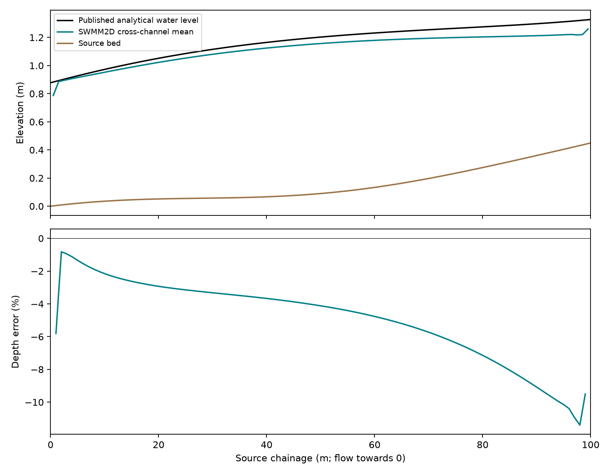
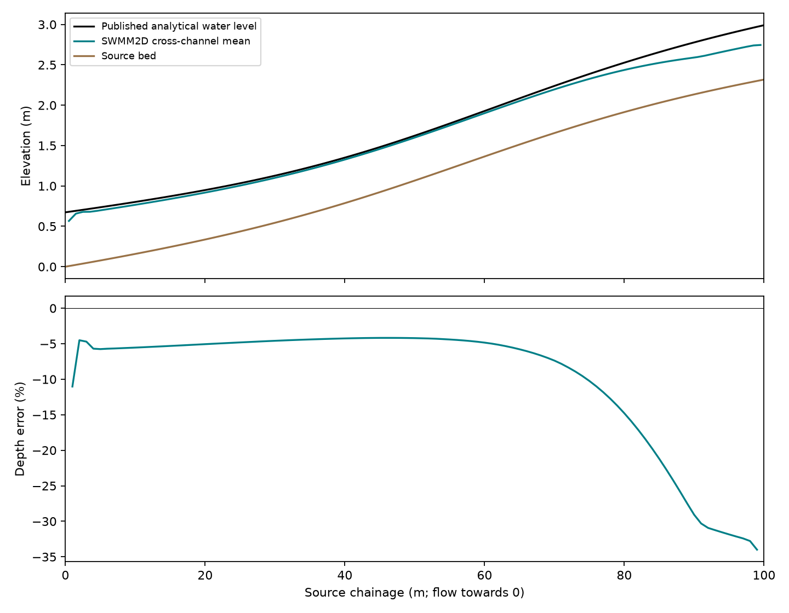
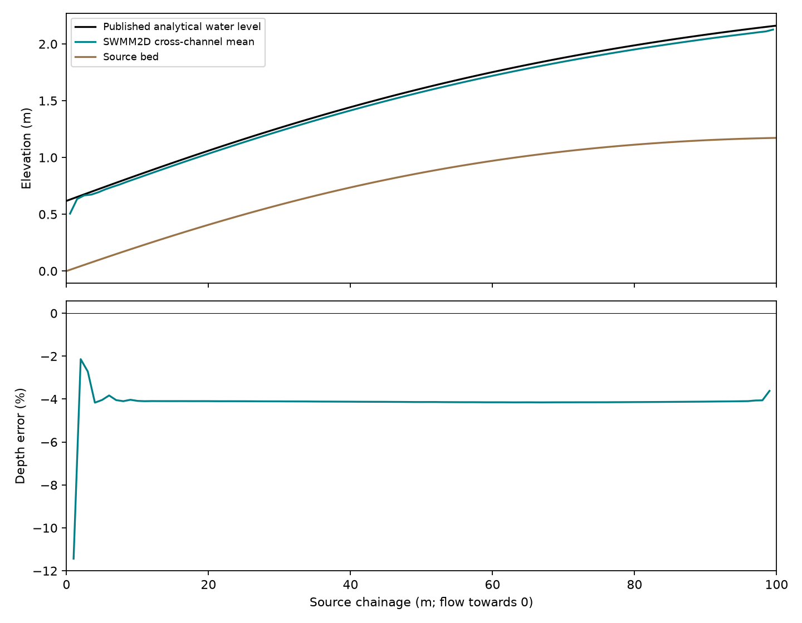
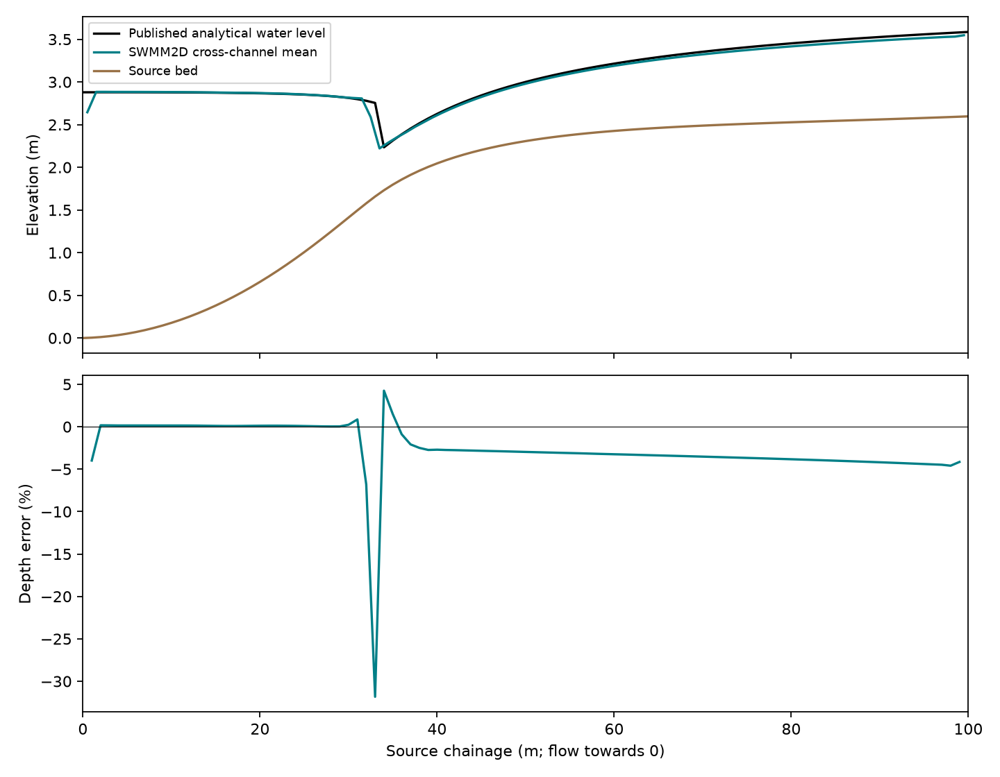
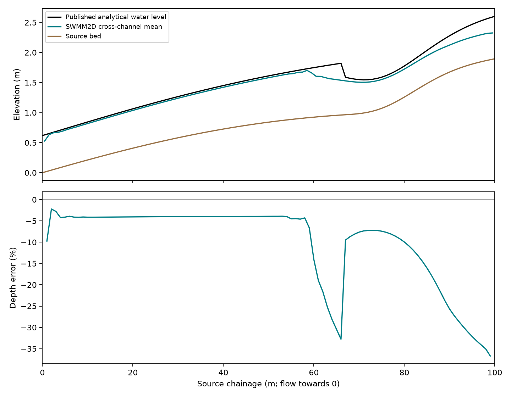
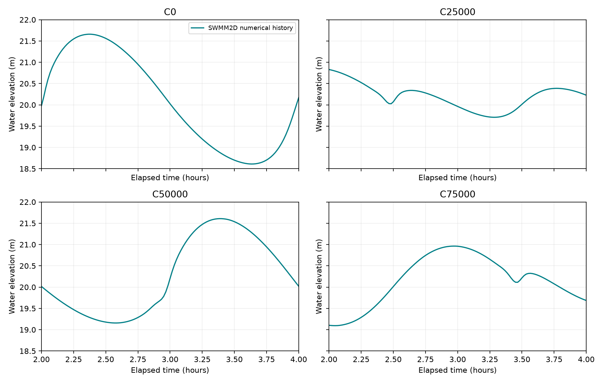
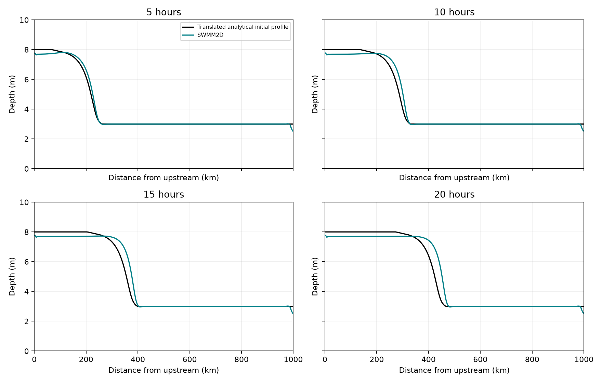
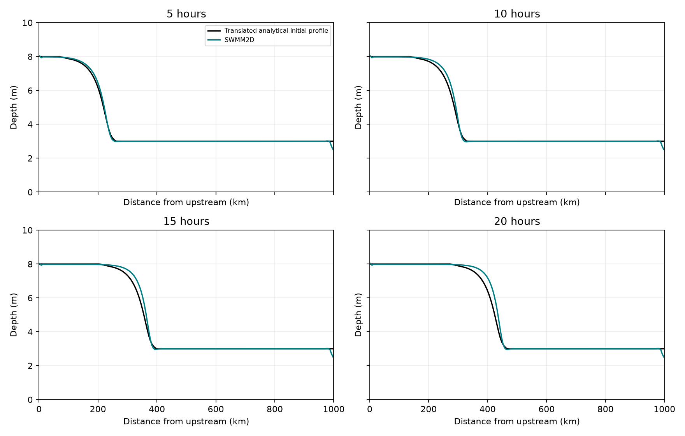
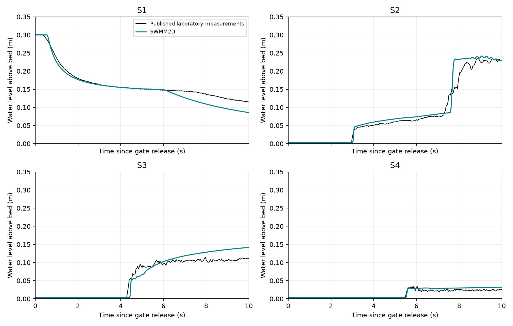
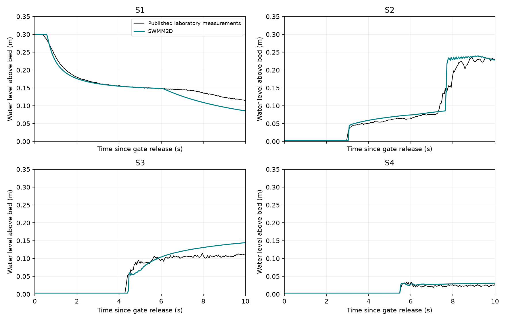

# W5-105 river benchmark supplement

SWMM2D reproductions of an earlier river-model benchmark collection, separate from the numbered SC120002 2D tests. All comparison lines are analytical or measured references. No competitor trace or ranking is used.

PASS below denotes complete, finite numerical output and conservation within 0.5%. It does not denote successful physical validation. Independent-reference residuals and numerical baseline changes are reported separately.

| Case | Numerical execution | Independent reference | Wall time (s) |
|---|---|---|---:|
| uk-river-a1 | PASS | compared | 3.82 |
| uk-river-a2 | PASS | compared | 5.24 |
| uk-river-a3 | PASS | compared | 4.11 |
| uk-river-a4 | PASS | compared | 4.50 |
| uk-river-a5 | PASS | compared | 5.51 |
| uk-river-e | PASS | unavailable | 0.38 |
| uk-river-f-mean | PASS | compared | 1.72 |
| uk-river-f-high | PASS | compared | 1.50 |
| uk-river-l | PASS | compared | 8.70 |
| uk-river-l-fine | PASS | compared | 68.09 |
| uk-river-j | UNAVAILABLE | Measured afflux targets imported; a faithful bridge and paired no-bridge model is pending. | 0.00 |

Coverage: 10/11 requested executions. Complete coverage: False. Scientific validation remains incomplete.

The executed binary and source identities are in each run manifest. All reference CSV files are checksum locked. Errors below have dimensional units of metres. No phase, time shift, roughness, or measurement scale is fitted to reduce them.

## Test A Part 1 quasi-steady flow

Continuity error: -8.64922e-12%. Saved output covers the full 3600 s simulation.

A transient SWMM2D march initialized from the analytical profile reproduces the source quasi-steady duration; no independent direct steady solver is claimed. SWMM2D applies bed Manning friction using depth; the source 1D solution includes finite-width hydraulic radius. Sidewall shear is not added or calibrated. The 1 m source spacing is retained along the flow; two 5 m-wide cells span the uniform 10 m section. Source cross sections/analytical levels are tabulated at 1 m. Linear interpolation onto cell centres is disclosed, especially across hydraulic jumps.

Dimensional reference errors are reported, not a calibrated accuracy gate. See case deviations for wall/friction and tabulation differences.

| Quantity / gauge | Samples | Bias (m) | RMSE (m) | Maximum absolute residual (m) |
|---|---:|---:|---:|---:|
| final profile | 99 | -0.0495513 | 0.0544463 | 0.101338 |

Own numerical baseline: unavailable. This is change control, separate from reference fit.

## Test A Part 2 quasi-steady flow

Continuity error: -1.90409e-12%. Saved output covers the full 3600 s simulation.

A transient SWMM2D march initialized from the analytical profile reproduces the source quasi-steady duration; no independent direct steady solver is claimed. SWMM2D applies bed Manning friction using depth; the source 1D solution includes finite-width hydraulic radius. Sidewall shear is not added or calibrated. The 1 m source spacing is retained along the flow; two 5 m-wide cells span the uniform 10 m section. Source cross sections/analytical levels are tabulated at 1 m. Linear interpolation onto cell centres is disclosed, especially across hydraulic jumps.

Dimensional reference errors are reported, not a calibrated accuracy gate. See case deviations for wall/friction and tabulation differences.

| Quantity / gauge | Samples | Bias (m) | RMSE (m) | Maximum absolute residual (m) |
|---|---:|---:|---:|---:|
| final profile | 99 | -0.0609985 | 0.0849486 | 0.228002 |

Own numerical baseline: unavailable. This is change control, separate from reference fit.

## Test A Part 3 quasi-steady flow

Continuity error: -4.55983e-12%. Saved output covers the full 3600 s simulation.

A transient SWMM2D march initialized from the analytical profile reproduces the source quasi-steady duration; no independent direct steady solver is claimed. SWMM2D applies bed Manning friction using depth; the source 1D solution includes finite-width hydraulic radius. Sidewall shear is not added or calibrated. The 1 m source spacing is retained along the flow; two 5 m-wide cells span the uniform 10 m section. Source cross sections/analytical levels are tabulated at 1 m. Linear interpolation onto cell centres is disclosed, especially across hydraulic jumps.

Dimensional reference errors are reported, not a calibrated accuracy gate. See case deviations for wall/friction and tabulation differences.

| Quantity / gauge | Samples | Bias (m) | RMSE (m) | Maximum absolute residual (m) |
|---|---:|---:|---:|---:|
| final profile | 99 | -0.0315653 | 0.0321884 | 0.0708038 |

Own numerical baseline: unavailable. This is change control, separate from reference fit.

## Test A Part 4 quasi-steady flow

Continuity error: 2.15203e-11%. Saved output covers the full 3600 s simulation.

A transient SWMM2D march initialized from the analytical profile reproduces the source quasi-steady duration; no independent direct steady solver is claimed. SWMM2D applies bed Manning friction using depth; the source 1D solution includes finite-width hydraulic radius. Sidewall shear is not added or calibrated. The 1 m source spacing is retained along the flow; two 5 m-wide cells span the uniform 10 m section. Source cross sections/analytical levels are tabulated at 1 m. Linear interpolation onto cell centres is disclosed, especially across hydraulic jumps.

Dimensional reference errors are reported, not a calibrated accuracy gate. See case deviations for wall/friction and tabulation differences.

| Quantity / gauge | Samples | Bias (m) | RMSE (m) | Maximum absolute residual (m) |
|---|---:|---:|---:|---:|
| final profile | 99 | -0.0230388 | 0.0451989 | 0.348989 |

Own numerical baseline: unavailable. This is change control, separate from reference fit.

## Test A Part 5 quasi-steady flow

Continuity error: -6.20781e-12%. Saved output covers the full 3600 s simulation.

A transient SWMM2D march initialized from the analytical profile reproduces the source quasi-steady duration; no independent direct steady solver is claimed. SWMM2D applies bed Manning friction using depth; the source 1D solution includes finite-width hydraulic radius. Sidewall shear is not added or calibrated. The 1 m source spacing is retained along the flow; two 5 m-wide cells span the uniform 10 m section. Source cross sections/analytical levels are tabulated at 1 m. Linear interpolation onto cell centres is disclosed, especially across hydraulic jumps.

Dimensional reference errors are reported, not a calibrated accuracy gate. See case deviations for wall/friction and tabulation differences.

| Quantity / gauge | Samples | Bias (m) | RMSE (m) | Maximum absolute residual (m) |
|---|---:|---:|---:|---:|
| final profile | 99 | -0.0673357 | 0.0963629 | 0.282191 |

Own numerical baseline: unavailable. This is change control, separate from reference fit.

## Test E Ippen tidal-wave scenario

Continuity error: -1.15431e-14%. Saved output covers the full 14400 s simulation.

Full nonlinear SWE with quadratic Manning friction; Ippen's linearized equation is an approximate comparator. Use the specified sine stage forcing and initial 20 m still water. Published reference phase/linear-friction ambiguity remains unresolved; no analytical accuracy verdict is issued.

TR2E section 4.3 identifies a sine/cosine boundary phase conflict. Appendix A also leaves the representative velocity for linear friction unspecified. No parameter fitting or phase shift is applied to manufacture agreement.

Own numerical baseline: unavailable. This is change control, separate from reference fit.

## Test F monoclinal wave, Manning 0.0241

Continuity error: -4.51291e-13%. Saved output covers the full 108000 s simulation.

Reference is the published analytical initial profile translated at 3.7989396 m/s, using linear interpolation of its 5 km samples. Constant Manning roughness reproduces the reported variants but differs from the constant Chezy law defining the analytical wave. Reference errors include this model-form difference.

Dimensional reference errors are reported, not a calibrated accuracy gate. See case deviations for wall/friction and tabulation differences.

| Quantity / gauge | Samples | Bias (m) | RMSE (m) | Maximum absolute residual (m) |
|---|---:|---:|---:|---:|
| 18000 | 200 | 0.00673283 | 0.151606 | 0.570206 |
| 36000 | 200 | 0.0174275 | 0.27064 | 1.16484 |
| 54000 | 200 | 0.028123 | 0.384513 | 1.7392 |
| 72000 | 200 | 0.0388188 | 0.492066 | 2.25501 |

Own numerical baseline: unavailable. This is change control, separate from reference fit.

## Test F monoclinal wave, Manning 0.0256

Continuity error: 1.57952e-12%. Saved output covers the full 108000 s simulation.

Reference is the published analytical initial profile translated at 3.7989396 m/s, using linear interpolation of its 5 km samples. Constant Manning roughness reproduces the reported variants but differs from the constant Chezy law defining the analytical wave. Reference errors include this model-form difference.

Dimensional reference errors are reported, not a calibrated accuracy gate. See case deviations for wall/friction and tabulation differences.

| Quantity / gauge | Samples | Bias (m) | RMSE (m) | Maximum absolute residual (m) |
|---|---:|---:|---:|---:|
| 18000 | 200 | 0.0118894 | 0.0747658 | 0.481154 |
| 36000 | 200 | 0.0280453 | 0.123984 | 0.524815 |
| 54000 | 200 | 0.044197 | 0.174084 | 0.765182 |
| 72000 | 200 | 0.0603486 | 0.224696 | 1.0138 |

Own numerical baseline: unavailable. This is change control, separate from reference fit.

## Test L CADAM constricted-channel dam break

Continuity error: 6.5422e-12%. Saved output covers the full 10 s simulation.

The physical 19.3 m laboratory channel is represented directly. This differs from the result report's extended 40 m reservoir and delayed analytical initialization. The initial dam is removed instantaneously at t=0; the physical gate opened in approximately 0.2 s. No fitted time shift. The 45-degree constriction tapers are fitted by nonrectangular quads; no staircase or artificial raised terrain substitutes for the walls. Gauge predictions use the containing cell. Instrument spatial averaging and uncertainty are not supplied.

All source observations after the first required output; no visibility selection or fitted time shift. Rounding +/-0.0005 m; instrument uncertainty unknown.

| Quantity / gauge | Samples | Bias (m) | RMSE (m) | Maximum absolute residual (m) |
|---|---:|---:|---:|---:|
| S1 | 250 | -0.00993079 | 0.0155674 | 0.0299868 |
| S2 | 250 | 0.00668442 | 0.0169861 | 0.081614 |
| S3 | 250 | 0.00615586 | 0.0162441 | 0.049 |
| S4 | 250 | 0.00247171 | 0.00439653 | 0.0104775 |

Own numerical baseline: unavailable. This is change control, separate from reference fit.

## Test L CADAM constricted-channel dam break (finer mesh)

Continuity error: 2.33735e-11%. Saved output covers the full 10 s simulation.

The physical 19.3 m laboratory channel is represented directly. This differs from the result report's extended 40 m reservoir and delayed analytical initialization. The initial dam is removed instantaneously at t=0; the physical gate opened in approximately 0.2 s. No fitted time shift. The 45-degree constriction tapers are fitted by nonrectangular quads; no staircase or artificial raised terrain substitutes for the walls. Gauge predictions use the containing cell. Instrument spatial averaging and uncertainty are not supplied.

All source observations after the first required output; no visibility selection or fitted time shift. Rounding +/-0.0005 m; instrument uncertainty unknown.

| Quantity / gauge | Samples | Bias (m) | RMSE (m) | Maximum absolute residual (m) |
|---|---:|---:|---:|---:|
| S1 | 250 | -0.0101939 | 0.015646 | 0.0300048 |
| S2 | 250 | 0.00632061 | 0.0172019 | 0.0845605 |
| S3 | 250 | 0.00735046 | 0.0174757 | 0.049 |
| S4 | 250 | 0.00216809 | 0.0038845 | 0.0106251 |

Own numerical baseline: unavailable. This is change control, separate from reference fit.

## Laboratory mesh sensitivity

This is a two-grid diagnostic, not an order-of-convergence estimate. Both grids fit the physical taper walls. Gate opening and gauge sampling remain additional uncertainty sources.

| Gauge | 0.05 m RMSE (m) | 0.025 m RMSE (m) |
|---|---:|---:|
| S1 | 0.0155674 | 0.015646 |
| S2 | 0.0169861 | 0.0172019 |
| S3 | 0.0162441 | 0.0174757 |
| S4 | 0.00439653 | 0.0038845 |

## Measured bridge targets and remaining coverage

Test J Table 4.1 supplies measured afflux values of 0.035/0.070 m for the two arch-bridge flows and 0.032/0.062 m for the two flat-soffit flows. They are preserved in the corpus. No SWMM2D bridge result is supplied here: a faithful structure plus paired no-bridge representation is still required. No projected opening or arbitrary point-loss substitute is labelled as the historical test.

Test E has numerical results but no qualified analytical residuals. The published report identifies a sine/cosine phase conflict, while the analytical linear-friction coefficient depends on an unspecified representative velocity. Neither parameter is fitted here.

The Test K and Test L result-PDF filenames are swapped; their cover titles and report identifiers determine their identity. The added references do not fill the original numbered 2D Test 6A or Test 8 input/measurement gaps.

The output register identifies available figure counterparts. Initial solver profiles and the measured laboratory comparison do not replace the source report's other diagnostic panels. No blanket claim of identical complete report coverage is made.

## Separate numerical repeat

Each executable configuration was run again against its reviewed numerical anchor, using matching input, analysis, reference and binary identities. This is a repeatability check, separate from the reference residuals above. Cross-platform tolerances remain unqualified.

| Configuration | Baseline check | Maximum absolute change in saved probe quantities |
|---|---|---:|
| uk-river-a1 | BASELINE-PASS | 0 |
| uk-river-a2 | BASELINE-PASS | 0 |
| uk-river-a3 | BASELINE-PASS | 0 |
| uk-river-a4 | BASELINE-PASS | 0 |
| uk-river-a5 | BASELINE-PASS | 0 |
| uk-river-e | BASELINE-PASS | 0 |
| uk-river-f-mean | BASELINE-PASS | 0 |
| uk-river-f-high | BASELINE-PASS | 0 |
| uk-river-l | BASELINE-PASS | 0 |
| uk-river-l-fine | BASELINE-PASS | 0 |

[Repeated-run identity records](regression-repeat.json)
