# Test 6: selective wall-friction sensitivity

All 9 planned configurations have completed.

These runs compare HydroCouple configurations only with the available measured subset. Cw is a declared diagnostic coefficient, not calibrated wall-material roughness. Bed roughness, mesh, initial depths and Coriolis OFF are held fixed. Every control uses accepted cell q/h velocity output and the same global stage schedule; Cs=0 means no interior Smagorinsky stress. Thus the historical free-slip RT0 velocity report is not silently used as the control for a different velocity operator.

Source: [Environment Agency SC120002 (2013), Figures 4.25–4.28](https://assets.publishing.service.gov.uk/media/6033a943d3bf7f721f4b0d49/_SC120002_Benchmarking_2D_hydraulic_models_Report.pdf).

Test 6A observations are digitized isolated UCL markers, not the original complete measurement series. G6 is unavailable. Reported errors apply only to the recoverable sample intervals. Test 6B has no independent measured reference.

## Experimental design

The wall condition remains impermeable. Its optional tangential traction is `tau_t/rho = -Cw |u_t| u_t`, with no factor of one half in this coefficient definition. The force uses the selected edge length and wetted wall height. Resolved pressure forces around the obstruction already supply form drag; this experiment adds skin friction only. Cw=0 retains free slip. A roughness or smooth-wall function would need wall-material and near-wall-resolution evidence; the present prescribed coefficient does not establish either.

All runs use CPU full shallow-water equations, second-order reconstruction, one timestep tier, CFL 0.4 and a 0.0001 m dry threshold. Smagorinsky uses `nu_t = (Cs sqrt(A))^2 |S|`; Cs=0 is the no-mixing control and Cs=0.1 is the mixing sensitivity. Neither coefficient was selected by minimizing measurement error. No fitted time shift is applied.

The constrained TIN has 61,642 triangular cells. Geometry follows the dimensioned flume drawing, including the banks, dam abutments and rotated building; it is not a vertexwise reproduction of the pixelated DEM. Bank toes and the gate-release depth discontinuity are shared internal constraints, never solid walls. Test 6B scales both horizontal coordinates and elevations by 20 according to the written specification. The supplied 6B DEM elevation conflict remains a documented interpretation.

| Test | Duration (s) | Report interval (s) | Bed Manning n | Wettable area (m²) |
|---|---:|---:|---:|---:|
| 6A | 120 | 0.1 | 0.01 | 354 |
| 6B | 1800 | 1.0 | 0.05 | 141600 |

Execution host: Apple M1 Max (MacBookPro18,2), 32 GiB RAM, 10 physical cores. Each case uses one solver thread. A fixed CPU clock frequency and minimum hardware requirement are not established by this experiment.

| Selected solid-wall region | Faces | Length in 6A (m) | Length in 6B (m) |
|---|---:|---:|---:|
| THROAT | 16 | 1.6 | 32 |
| OBSTRUCTION | 24 | 2.4 | 48 |
| OTHER_WALLS | 2098 | 208.8 | 4176 |

The all-walls control also applies the same Cw to OTHER_WALLS; regional cases retain free slip there. Named assignments are retained in the executed inputs. In the GUI, select exterior edges, choose Wall, set the Wall friction Cw field, and use the boundary Group control to keep throat and obstruction selections separate. Undo/redo, the edge table and INP export use the same assignments.

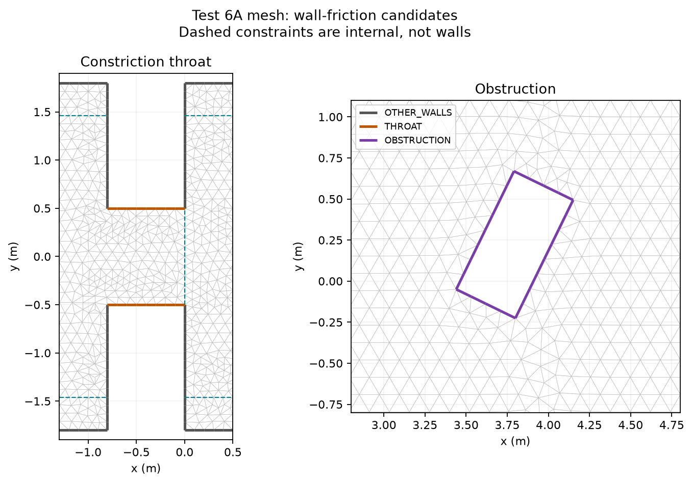

## Reference and sampling limits

Only isolated visible UCL measurement diamonds from the 2013 report are used. Continuous curves from other solvers are excluded. Occluded markers are missing, same-pixel time samples were averaged, and instrument uncertainty is unknown. This visibility-selected subset cannot establish fit to the complete experiment. The original complete measurement series and an independent second-person digitization remain unavailable.

Model probes use the containing cell, with the lowest cell index on a shared-edge tie. Levels are cell bed plus depth and speeds are the accepted momentum divided by depth. Model histories are interpolated at recovered measurement times. Dry cells are masked in the plots; G6 has no recovered observations. Test 6B has no independent physical reference and is assessed only for numerical behavior.

| Probe / quantity | Recovered samples | Weighted covered duration (s) |
|---|---:|---:|
| G2 / level_m | 39 | 7.0247 |
| G2 / speed_mps | 141 | 17.9162 |
| G4 / level_m | 41 | 13.4694 |
| G4 / speed_mps | 117 | 23.0075 |
| G5 / level_m | 108 | 18.8829 |

Residuals use trapezoidal time weights within recovered segments; gaps longer than 1 s are not bridged. Covered duration is the sum of those segment durations, not uninterrupted measurement coverage. The errors below are report-only diagnostics and are not regression pass/fail thresholds.

## Numerical evidence and reproducibility

| Case | Depth / continuity / volume checks | Elapsed time (s) | Input | Audit | Gauge histories |
|---|---|---:|---|---|---|
| 6a-cs0-all-cw0.01 | PASS / PASS / PASS | 707.6 | [INP](6a-cs0-all-cw0.01/model.inp) | [metrics](6a-cs0-all-cw0.01/metrics.json), [identity](6a-cs0-all-cw0.01/manifest.json) | [CSV](6a-cs0-all-cw0.01/probes.csv) |
| 6a-cs0-both-cw0.01 | PASS / PASS / PASS | 827.2 | [INP](6a-cs0-both-cw0.01/model.inp) | [metrics](6a-cs0-both-cw0.01/metrics.json), [identity](6a-cs0-both-cw0.01/manifest.json) | [CSV](6a-cs0-both-cw0.01/probes.csv) |
| 6a-cs0-none-cw0.01 | PASS / PASS / PASS | 699.3 | [INP](6a-cs0-none-cw0.01/model.inp) | [metrics](6a-cs0-none-cw0.01/metrics.json), [identity](6a-cs0-none-cw0.01/manifest.json) | [CSV](6a-cs0-none-cw0.01/probes.csv) |
| 6a-cs0-obstruction-cw0.01 | PASS / PASS / PASS | 813.5 | [INP](6a-cs0-obstruction-cw0.01/model.inp) | [metrics](6a-cs0-obstruction-cw0.01/metrics.json), [identity](6a-cs0-obstruction-cw0.01/manifest.json) | [CSV](6a-cs0-obstruction-cw0.01/probes.csv) |
| 6a-cs0-throat-cw0.01 | PASS / PASS / PASS | 695.6 | [INP](6a-cs0-throat-cw0.01/model.inp) | [metrics](6a-cs0-throat-cw0.01/metrics.json), [identity](6a-cs0-throat-cw0.01/manifest.json) | [CSV](6a-cs0-throat-cw0.01/probes.csv) |
| 6a-cs0.1-both-cw0.01 | PASS / PASS / PASS | 3070.3 | [INP](6a-cs0.1-both-cw0.01/model.inp) | [metrics](6a-cs0.1-both-cw0.01/metrics.json), [identity](6a-cs0.1-both-cw0.01/manifest.json) | [CSV](6a-cs0.1-both-cw0.01/probes.csv) |
| 6a-cs0.1-none-cw0.01 | PASS / PASS / PASS | 3095.9 | [INP](6a-cs0.1-none-cw0.01/model.inp) | [metrics](6a-cs0.1-none-cw0.01/metrics.json), [identity](6a-cs0.1-none-cw0.01/manifest.json) | [CSV](6a-cs0.1-none-cw0.01/probes.csv) |
| 6b-cs0.1-both-cw0.01 | PASS / PASS / PASS | 8025.4 | [INP](6b-cs0.1-both-cw0.01/model.inp) | [metrics](6b-cs0.1-both-cw0.01/metrics.json), [identity](6b-cs0.1-both-cw0.01/manifest.json) | [CSV](6b-cs0.1-both-cw0.01/probes.csv) |
| 6b-cs0.1-none-cw0.01 | PASS / PASS / PASS | 8101.2 | [INP](6b-cs0.1-none-cw0.01/model.inp) | [metrics](6b-cs0.1-none-cw0.01/metrics.json), [identity](6b-cs0.1-none-cw0.01/manifest.json) | [CSV](6b-cs0.1-none-cw0.01/probes.csv) |

The extractor requires every scheduled output through the full duration, finite saved fields, nonnegative depths, an accepted solver conservation ledger and an independently integrated volume balance. Native 0.1 s and 1 s report-clock preflights also check an analytical wall-channel velocity before expensive runs. Earlier attempts with ambiguous numeric report-step tokens had no output frames and were rejected; none of their data enter this assessment.

The [build record](build-provenance.json) and per-case identity files retain exact CLI/library hashes, input hashes and analysis identity. Source inputs come from committed corpus revision 0e60707, preserving the separately edited working input. [Assessment plan](assessment-plan.json). Runs share machine resources, so their elapsed times are not controlled performance comparisons. Analytical and authoring tests qualify the implementation; mesh/timestep sensitivity and material roughness qualification remain necessary before adopting a closure.

## Measured-subset errors and wall dissipation

The tested wall and mixing settings do not explain the main Test 6A G2 discrepancy. With free-slip walls, G2 speed RMSE is 0.821976 m/s without mixing and 0.821925 m/s with Cs=0.1. Adding Cw=0.01 at the throat and obstruction changes it to 0.819115 m/s without mixing and 0.817577 m/s with mixing. Extending the same coefficient to every exterior wall gives 0.818514 m/s without mixing, a reduction of only 0.42% relative to free slip. Wall-only effects are mixed across the level and speed records; with mixing, the selected throat and obstruction walls produce small reductions in all five recovered-series RMSEs. The wall-energy ledger confirms that traction was applied, but the G2 speed and level disagreement remains substantial. These results do not justify treating these settings as a correction to the benchmark or changing the off/free-slip defaults. All 9 configurations completed their prescribed durations and passed the saved-depth and water-balance checks.

The coefficients were declared diagnostic values, not measured or fitted wall roughness. The all-wall coverage control was added after the regional runs showed little G2 change, retaining the same coefficient. Errors cover only visibility-selected digitized UCL markers, with missing G6 observations and unknown instrument uncertainty; the small changes do not establish a physical cause. Original measurements, drawing-versus-DEM geometry qualification, mesh/timestep and probe-sampling sensitivity, and wall-material evidence are still needed. Test 6B uses the chosen elevation scaling of 20 and has no independent measured reference; its numerical checks cannot establish physical accuracy.

| Case | G2 speed RMSE (m/s) | G4 speed RMSE (m/s) | G2 level RMSE (m) | G4 level RMSE (m) | G5 level RMSE (m) | Volume residual (m³) | Wall energy/rho (m⁵/s²) |
|---|---:|---:|---:|---:|---:|---:|---:|
| 6a-cs0-all-cw0.01 | 0.818514 | 0.327059 | 0.0566922 | 0.0233603 | 0.0178662 | 2.4869e-14 | 0.089763 |
| 6a-cs0-both-cw0.01 | 0.819115 | 0.325722 | 0.0567369 | 0.0234243 | 0.0176858 | 2.4869e-14 | 0.0756191 |
| 6a-cs0-none-cw0.01 | 0.821976 | 0.325948 | 0.055899 | 0.0238486 | 0.0169816 | -1.42109e-14 | 0 |
| 6a-cs0-obstruction-cw0.01 | 0.824476 | 0.319977 | 0.0558136 | 0.0233382 | 0.017806 | -1.42109e-14 | 0.015736 |
| 6a-cs0-throat-cw0.01 | 0.81942 | 0.333609 | 0.0567848 | 0.0238443 | 0.0183323 | -3.55271e-15 | 0.0609351 |
| 6a-cs0.1-both-cw0.01 | 0.817577 | 0.324354 | 0.0564657 | 0.0223006 | 0.0159332 | 3.55271e-15 | 0.0733542 |
| 6a-cs0.1-none-cw0.01 | 0.821925 | 0.327883 | 0.056805 | 0.0231375 | 0.016055 | 1.42109e-14 | 0 |
| 6b-cs0.1-both-cw0.01 | — | — | — | — | — | -1.74623e-09 | 8003.01 |
| 6b-cs0.1-none-cw0.01 | — | — | — | — | — | -1.68802e-09 | 0 |

## Signed residuals against recovered measurements

Bias is model minus measurement. Positive speed bias means overprediction; water-level bias retains the common flume-bed datum.

| Case | Probe / quantity | Bias (m or m/s) | MAE (m or m/s) | Maximum absolute residual (m or m/s) |
|---|---|---:|---:|---:|
| 6a-cs0-all-cw0.01 | G2 / level_m | -0.0518423 | 0.0518423 | 0.085401 |
| 6a-cs0-all-cw0.01 | G2 / speed_mps | 0.608859 | 0.665911 | 1.40614 |
| 6a-cs0-all-cw0.01 | G4 / level_m | 0.0115004 | 0.0185832 | 0.0563128 |
| 6a-cs0-all-cw0.01 | G4 / speed_mps | -0.14921 | 0.217253 | 0.969977 |
| 6a-cs0-all-cw0.01 | G5 / level_m | -0.0100232 | 0.015227 | 0.0385232 |
| 6a-cs0-both-cw0.01 | G2 / level_m | -0.0518977 | 0.0518977 | 0.0854468 |
| 6a-cs0-both-cw0.01 | G2 / speed_mps | 0.609461 | 0.666369 | 1.41052 |
| 6a-cs0-both-cw0.01 | G4 / level_m | 0.0118373 | 0.0185568 | 0.056608 |
| 6a-cs0-both-cw0.01 | G4 / speed_mps | -0.151865 | 0.213122 | 0.972479 |
| 6a-cs0-both-cw0.01 | G5 / level_m | -0.0097352 | 0.0149733 | 0.0394157 |
| 6a-cs0-none-cw0.01 | G2 / level_m | -0.0508536 | 0.0508536 | 0.0842488 |
| 6a-cs0-none-cw0.01 | G2 / speed_mps | 0.611209 | 0.668129 | 1.41274 |
| 6a-cs0-none-cw0.01 | G4 / level_m | 0.0116251 | 0.0188965 | 0.0573069 |
| 6a-cs0-none-cw0.01 | G4 / speed_mps | -0.146716 | 0.213663 | 0.978321 |
| 6a-cs0-none-cw0.01 | G5 / level_m | -0.00826878 | 0.0135195 | 0.0421273 |
| 6a-cs0-obstruction-cw0.01 | G2 / level_m | -0.0507657 | 0.0507657 | 0.084622 |
| 6a-cs0-obstruction-cw0.01 | G2 / speed_mps | 0.613322 | 0.670243 | 1.4122 |
| 6a-cs0-obstruction-cw0.01 | G4 / level_m | 0.0106301 | 0.0191404 | 0.0561607 |
| 6a-cs0-obstruction-cw0.01 | G4 / speed_mps | -0.11327 | 0.214887 | 0.965461 |
| 6a-cs0-obstruction-cw0.01 | G5 / level_m | -0.00936312 | 0.0148584 | 0.0483056 |
| 6a-cs0-throat-cw0.01 | G2 / level_m | -0.0519429 | 0.0519429 | 0.0853539 |
| 6a-cs0-throat-cw0.01 | G2 / speed_mps | 0.609844 | 0.666758 | 1.40697 |
| 6a-cs0-throat-cw0.01 | G4 / level_m | 0.0111749 | 0.0190579 | 0.0571212 |
| 6a-cs0-throat-cw0.01 | G4 / speed_mps | -0.129107 | 0.224139 | 0.969382 |
| 6a-cs0-throat-cw0.01 | G5 / level_m | -0.00891311 | 0.0144687 | 0.0440663 |
| 6a-cs0.1-both-cw0.01 | G2 / level_m | -0.0515782 | 0.0515782 | 0.0854003 |
| 6a-cs0.1-both-cw0.01 | G2 / speed_mps | 0.607814 | 0.664784 | 1.40984 |
| 6a-cs0.1-both-cw0.01 | G4 / level_m | 0.01122 | 0.017625 | 0.0550835 |
| 6a-cs0.1-both-cw0.01 | G4 / speed_mps | -0.14491 | 0.212431 | 0.962665 |
| 6a-cs0.1-both-cw0.01 | G5 / level_m | -0.00667939 | 0.0130465 | 0.0421526 |
| 6a-cs0.1-none-cw0.01 | G2 / level_m | -0.051756 | 0.051756 | 0.0851374 |
| 6a-cs0.1-none-cw0.01 | G2 / speed_mps | 0.611623 | 0.668302 | 1.41033 |
| 6a-cs0.1-none-cw0.01 | G4 / level_m | 0.0106524 | 0.0187856 | 0.0552529 |
| 6a-cs0.1-none-cw0.01 | G4 / speed_mps | -0.143525 | 0.219997 | 0.968392 |
| 6a-cs0.1-none-cw0.01 | G5 / level_m | -0.00593006 | 0.01289 | 0.0422927 |

## Corresponding UK report panels

The first image of each pair retains the source panel axes; the companion exposes values outside those limits and the full duration. [Axis display specifications](figure-display-specs.json).

### Test 6A, Cs=0

Comparison uses the recovered UCL measurement subset.

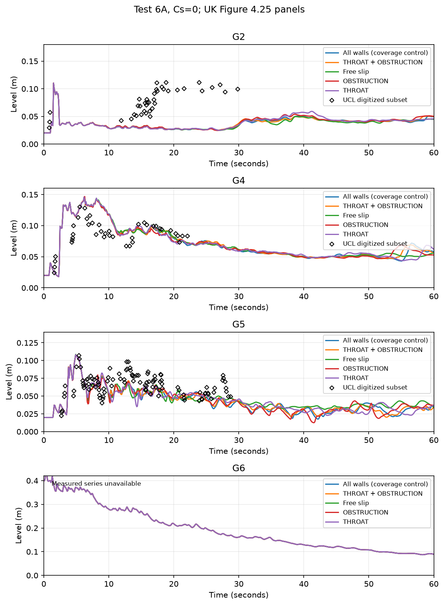

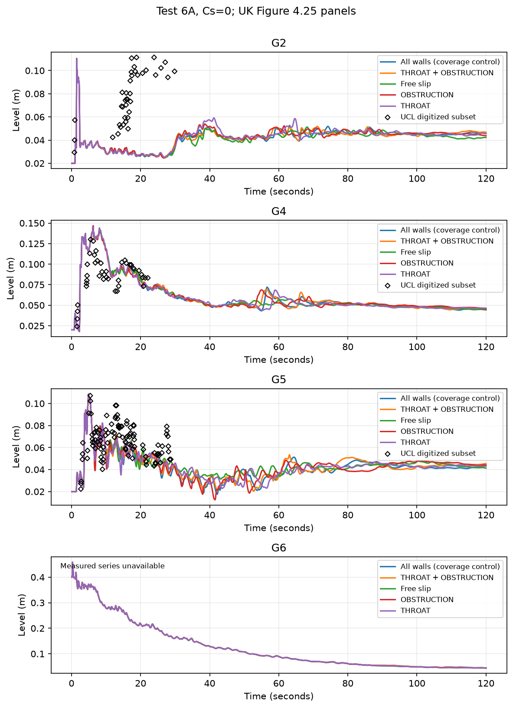

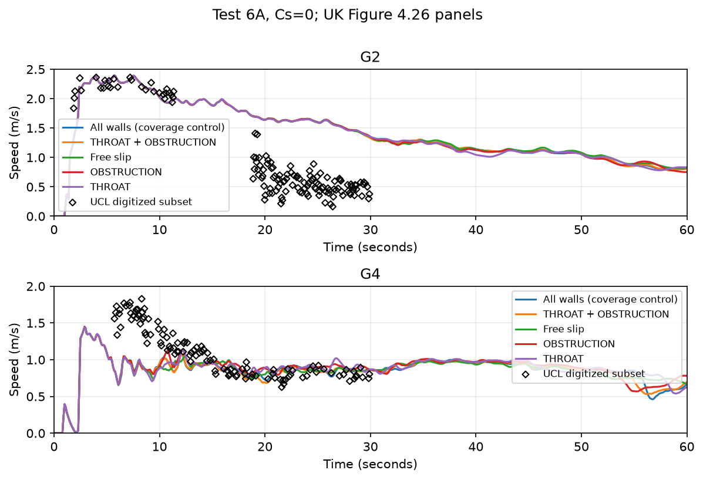

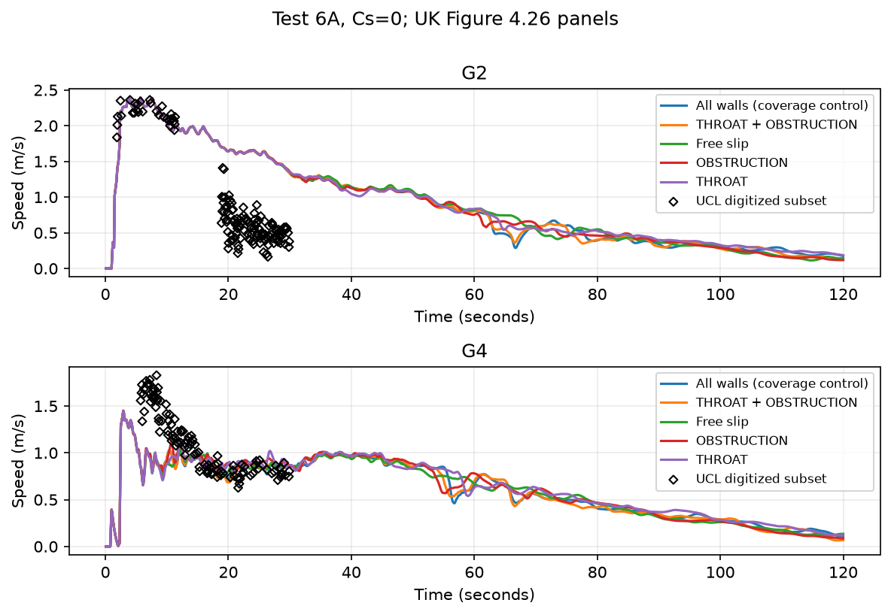

### Test 6A, Cs=0.1

Comparison uses the recovered UCL measurement subset.

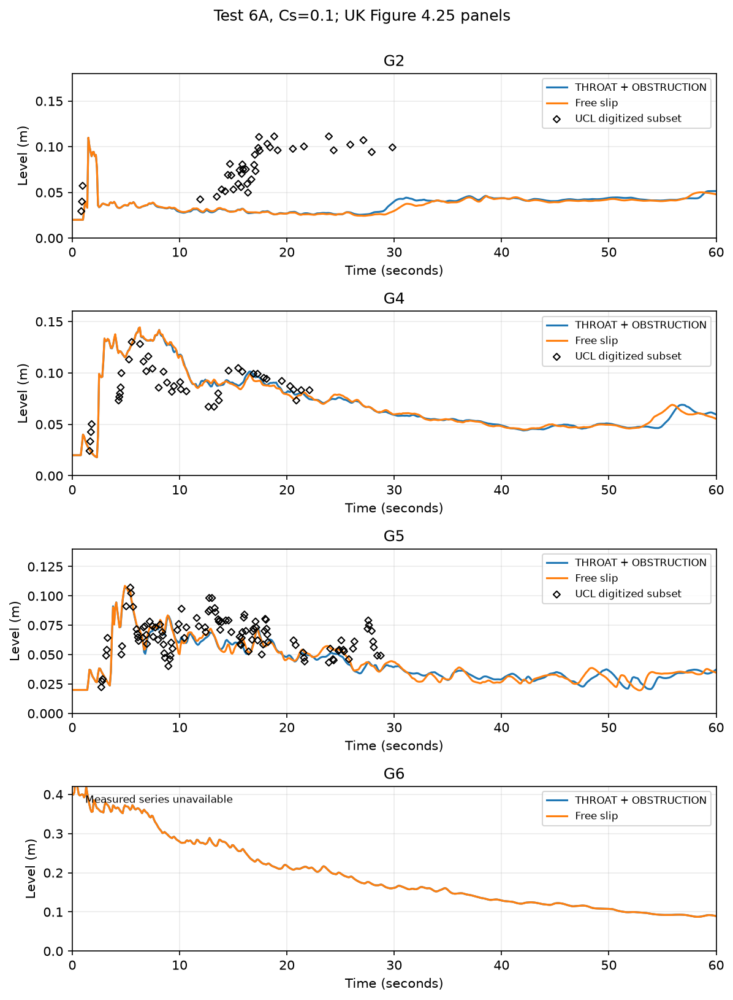

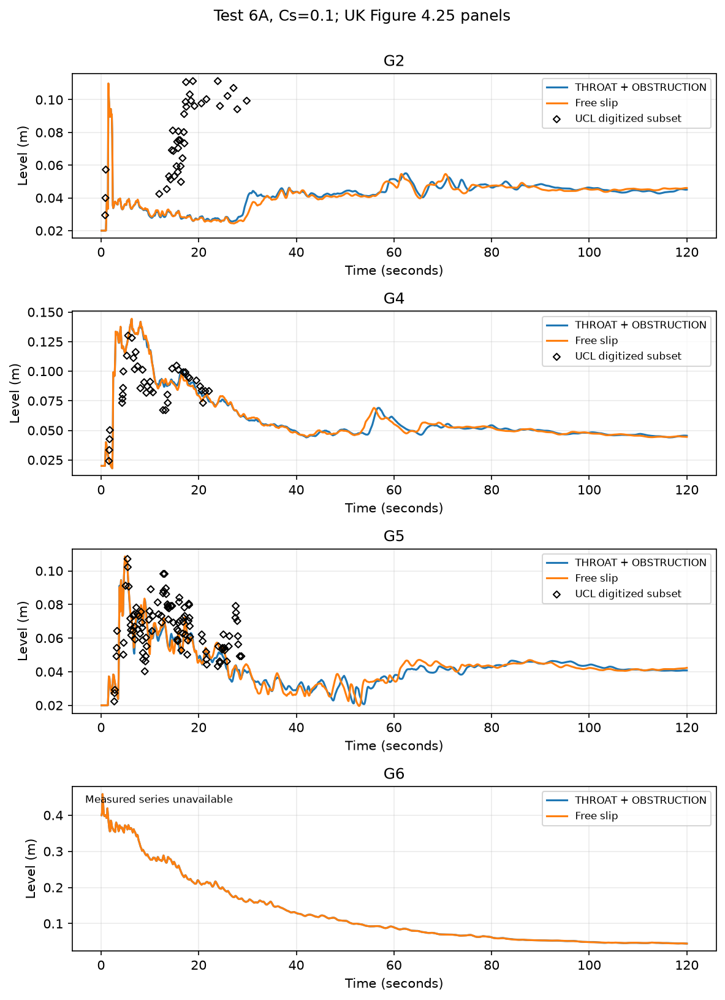

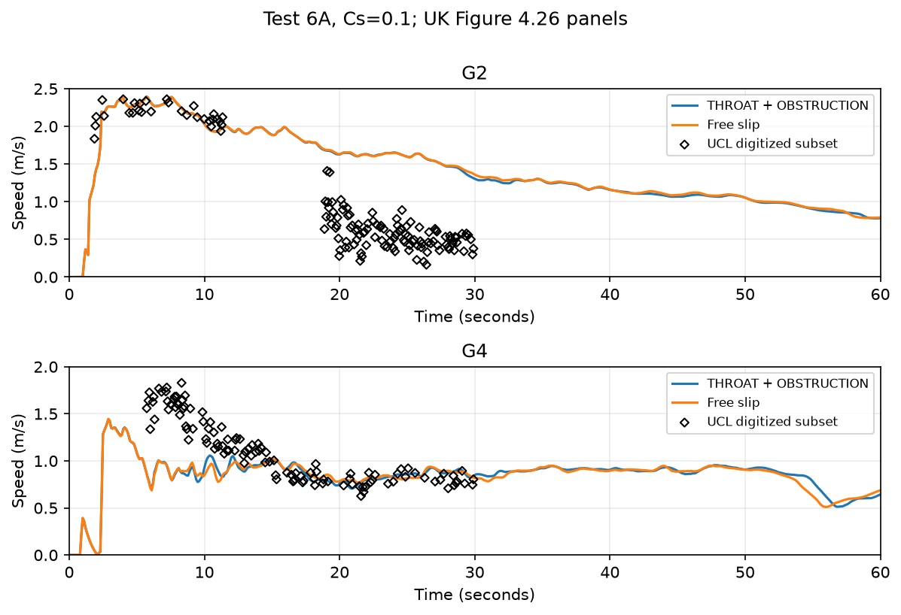

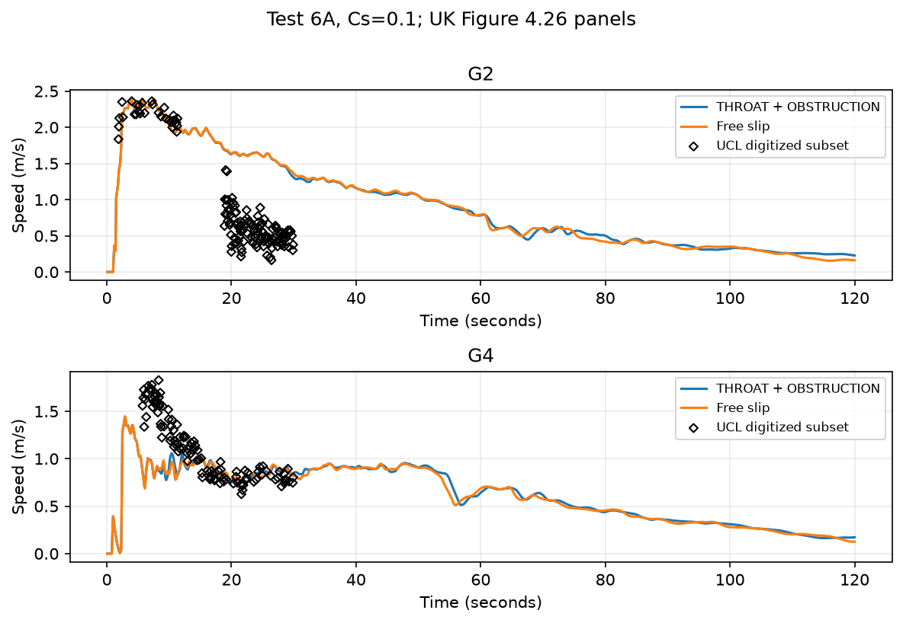

### Test 6B, Cs=0.1

Numerical sensitivity histories. An independent measured or analytical reference is unavailable.

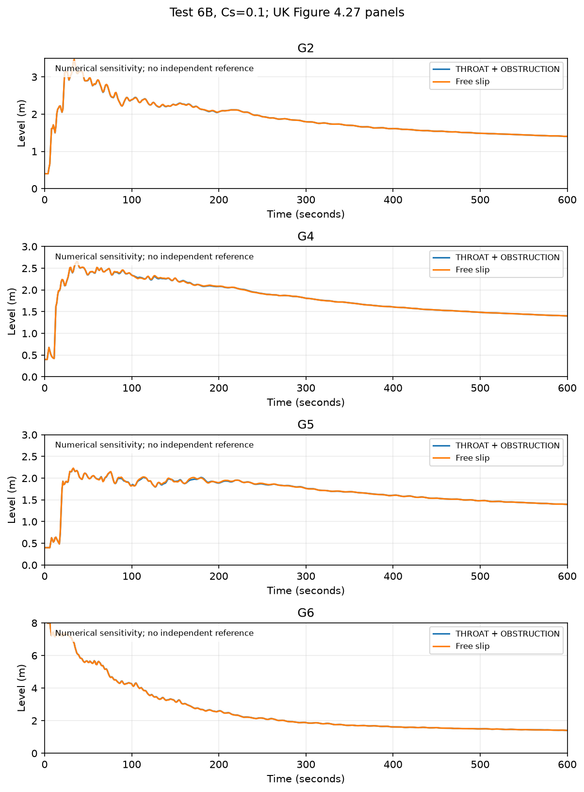

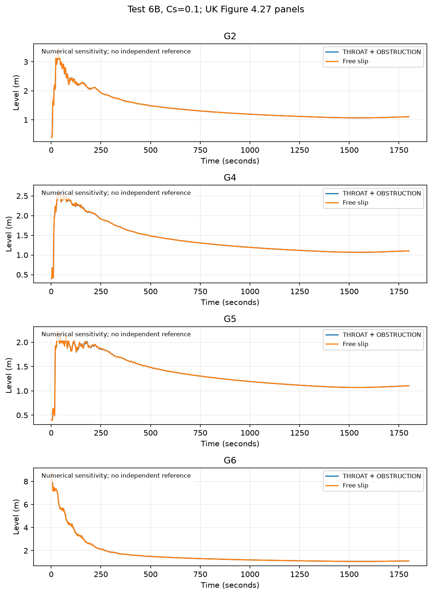

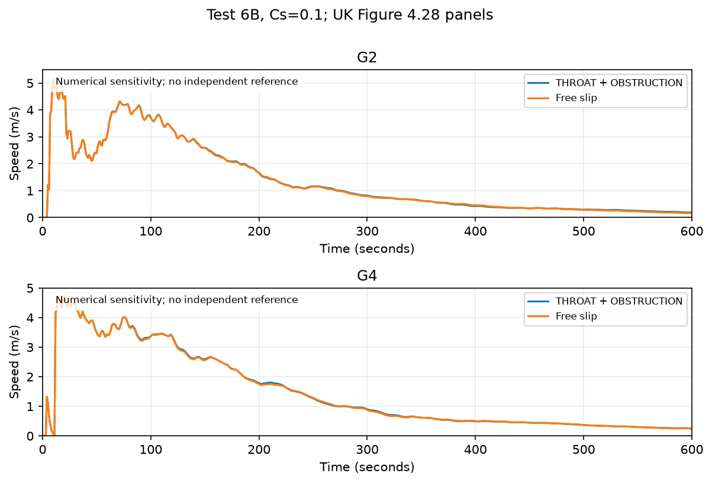

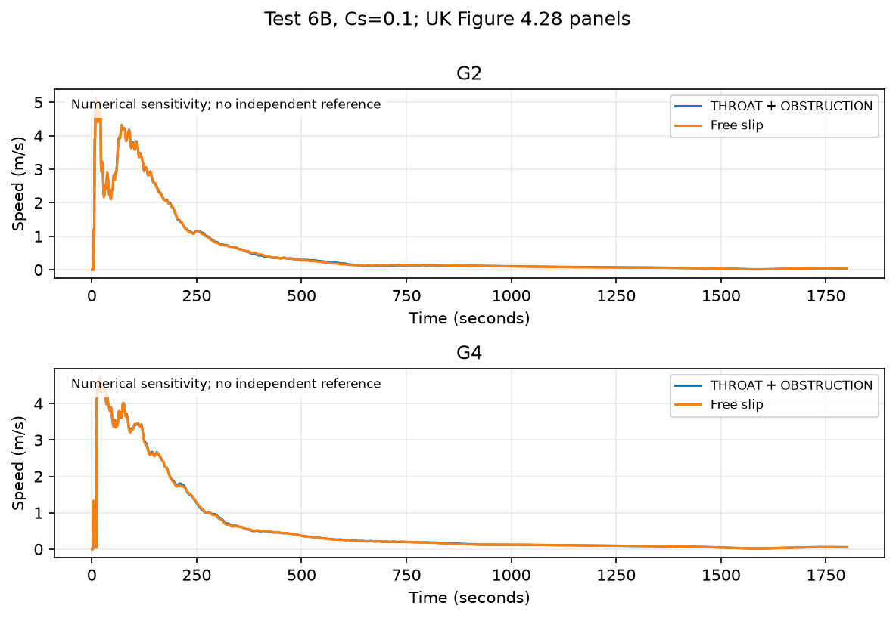

All cases retain model inputs, exact CLI/library hashes, wall groups, numerical checks and measured-fit metrics. A reduction at one gauge alone does not establish wall friction as the missing cause. Joint level/speed histories and mesh/timestep sensitivity must support any selected closure.
